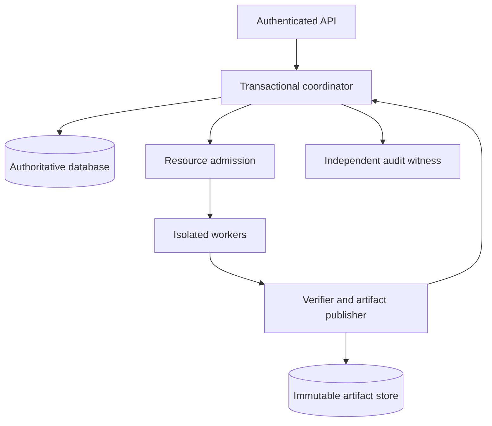

# MIZAN | Final Codex build brief 2.1

21 November 2026 · SANAD, BASIRA and RASID · Local CPU release and production architecture

The local coordinator owns publication. SANAD must prove a procurement verdict from approved source spans, BASIRA must report what its calibration sample permits, and RASID must settle a physically valid plan against the actual tariff. The shared release boundary is a signed result tied to the exact job, attempt, input and deployment. Cluster failover and external witnessing require separately qualified authorities.

> **Release 3.0 addendum.** Read `docs/RELEASE_3.0.md` first. It adds the MCP agent interface (no authority tools), proof-rendered bilingual explanations with executed counterfactuals, in-browser verification of the exhibit, deterministic simulation of the broker and a metamorphic safety suite with mutants. Resolve technical conflicts in the order 3.0, 2.3, 2.2, 2.1, 2.0, then the original brief.
>
> **Release 2.3 addendum.** Read `docs/RELEASE_2.3.md`, then `docs/RELEASE_2.2.md`. Release 2.3 adds per-bank (PAC) conformal guarantees, a decision-quality RASID evaluation, SANAD table grammar 3 and an audit-witness protocol simulation. Run `python -m mizan upgrade` once for stores from 2.1 or 2.2.
>
> **Release 2.2 addendum.** Read `docs/RELEASE_2.2.md` first. It records the code review of 2.1 (runner survival, constant-time result lookup, shutdown re-queue, offline verification of job outputs) and SANAD grammar 2 with signed operator acknowledgement of non-evidential lines. Resolve technical conflicts in the order 2.3, 2.2, 2.1, 2.0, then the original brief. Stores created by 2.1 migrate their schema automatically; run `python -m mizan upgrade` once for SANAD.

## Codex execution prompt | copy from here

You are the lead engineer continuing MIZAN in this workspace. Deliver a portfolio that a hiring engineer can inspect, run and challenge. Use concrete design decisions, readable source code, reproducible measurements and honest limitations. Write the technical work in English and the owner's handoff in clear Arabic.

Start by locating the existing Python package, tests, examples, reports and static Space folders. Read the final changes and normative architecture included below. The source product brief is bundled at `docs/design/BUILD_BRIEF_v1.pdf`. Resolve technical conflicts in the order 2.1, then 2.0, then the original product brief. Preserve working code and existing user changes.

1. Identify the active Python and SQLite builds, CPU, available RAM, disk, network and optional checkpoint cache. Use a project-local environment. Install core dependencies from the manifest for this release. Run the actual application tests and the reference checks. Record actionable failures and fix recoverable ones before progressing.
2. Execute all three products through the normal CLI or authenticated API, using the included sample inputs in a fresh data directory. Verify the signed outputs and retain actual configuration, input identity, model/profile revision and measured outcomes. Test stale job publication, signed restore to a new generation and rollback with a revoked or incompatible target. Preserve any failing evidence as an explicit gate.
3. For SANAD, compare both authority policies on the bilingual UPS case. Show the difference in the apparent-power verdict, the exact surrounding source span and which computations were reused. Apply signed source approval outside the documents. Track abstention separately from wrong approvals.
4. For BASIRA, run the calibrated inspection and compare candidate and pixel baseline on the same part groups. Show both a true alert and a false alert, the minimum attainable p-value at m=4, and the criterion for future automatic clearance. Any descriptor or preprocessing change requires a separately identified bank and a new, frozen evaluation protocol.
5. For RASID, solve the two-hour hand oracle and the rolling-origin evaluation. Publish feasible versus diagnostic status, physical residuals, expected cost, CVaR, risk-adjusted objective, recalculated gap, realized cost and forecast error. Retain negative comparisons. Keep proposals and the independent verifier in separate modules.
6. On a machine with network access and adequate storage, use the optional Hugging Face path to import and compare the three pinned checkpoints. Check weight and companion-file integrity. Reproduce an earlier qualified CPU result before running a new candidate. Capture actual revision, software versions, elapsed time and memory. Keep checkpoint results separate until their gates pass. If access is unavailable, complete the core jobs and report which specific checkpoint remains untested.
7. Rebuild the three independent static Spaces from accepted results. Keep replayed fixtures clearly labeled. Verify that exports preserve original JSON numeric spellings and validate every exported signed receipt. If Chromium is available, run the desktop/mobile browser suite. Public publishing, paid resources and use of private data require the owner's explicit instruction.
8. Use the acceptance map to implement the next applicable, unqualified gate that the available infrastructure can genuinely exercise. For distributed failover, untrusted worker isolation, accelerator OOM and external witnessing, a simulation can test the protocol. Mark deployment qualification separately. Finish with the runnable commands, evidence paths, baseline comparisons and remaining blockers. Never invent a deployment URL, customer result, author history or qualification pass.

The release already contains a working local implementation. Build on that checkout. If only this document is supplied, implement the same three vertical slices under the contracts below, first producing one working local result per product. A design outline or a generated screen by itself does not meet the delivery criteria.

## Reproducible acceptance entry points

Run from the extracted MIZAN folder with the specified dependencies installed.

```bash
python -m mizan doctor
python -m unittest discover -s tests -v
python verification/reference_checks.py reports/reference_verification.json
python -m mizan --data var/acceptance run sanad examples/sanad.json --out reports/sanad-run.json
python -m mizan --data var/acceptance run basira examples/basira.json --out reports/basira-run.json
python -m mizan --data var/acceptance run rasid examples/rasid.json --out reports/rasid-run.json
python -m mizan --data var/acceptance run rasid examples/rasid_oracle.json --out reports/oracle-run.json
python -m mizan --data var/acceptance demo --out reports/acceptance-demo
python scripts/verify_exhibit.py reports/acceptance-demo/demo_results.json
OPENBLAS_NUM_THREADS=1 OMP_NUM_THREADS=1 python scripts/evaluate.py --days 60
python scripts/build_spaces.py --source reports/acceptance-demo/demo_results.json --out spaces-rebuilt
```

For the original bundled results, the separately pinned local-demo key fingerprint for this handoff is `9a627609771982875b75b6b28ff59091f40c5a116df11c1fffb94f37a51df436`. A new local store will generate its own key. A fingerprint shipped in the same distribution is a comparison reference; independent publisher trust requires obtaining it through a trusted channel.

## Reading order

Part I specifies final implementation contracts. Part II reproduces the complete amended technical architecture, including source-page findings, formulas, fault cases, promotion/rollback guards and references. Part III records what actually ran. Prior dates and statements about reference-only tests in Part II describe the architecture review at its original issue date.

---

# Part I · Final implementation contracts

# MIZAN 2.1 | Final build contract and release evidence

Released 21 November 2026. The design under review is the 50-page BUILD BRIEF v1.0. The 2.0 amendment appears in full after these final changes. Its 16 source-page findings, 10 invariants and 28 acceptance cases remain the baseline. This update resolves implementation ambiguities surfaced by the working CPU systems and defines the evidence needed to advance them.

## 1. Execution model and state ownership

**Local release.** One coordinator process owns the local WAL database and its signing authority. An advisory host lock excludes a second broker. Read-only exhibit mode starts without opening the store. The database uses full synchronization, foreign keys, bounded busy waits and write transactions that acquire the writer slot up front. The scheduler records a monotonically increasing turn for each tenant it dispatches. Eligibility precedes selection, then least recently served tenant and FIFO arrival order determine the next assignment. The default admits up to 64 outstanding jobs and one physical execution. A restarted process preserves tenant turns.

**Publication predicate.** A worker submits a proposal. The coordinator verifies it, writes immutable content by digest, then inside one write transaction checks the job, tenant, kind, payload and profile identities, current generation, attempt epoch, cancellation counter, running state, live lease, active deployment revision and revocation. It installs the signed result reference and appends its audit event together. A retry may recompute a result. At most one attempt commits it. The artifact collector and staging path serialize locally. An orphan from an interrupted attempt may be collected after the grace period.

**Crash oracle.** Kill the process immediately before commit and immediately after commit. On reopen the former case must yield a reclaimable job and collectible orphan. The latter must yield a verifiable committed result. Reject an old token after rollback, cancellation or restoration to a new generation. Exercise this against the actual coordinator as well as the transaction reference model.

**Distributed extension.** A queue message is a wake-up hint. Durable eligibility, authority generation, attempt fencing and cancellation belong in the transactional control plane. Claim an eligible row with a short locked transaction. Within each tenant partition give bounded quotas to interactive work, batch work and maintenance. Age eligible work to prevent starvation. Reserve all required device and host resources together or release the partial reservation before waiting. Never hold a transaction across model execution, network I/O or acknowledgment from a witness. Use the ordered resource acquisition and bounded whole-transaction retry rules in §3 of the attached amendment. Permit primary takeover only after fencing the prior authority and validating the acknowledged recovery frontier. Wall-clock expiry alone cannot authorize two primaries. Profile D remains gated pending a real partition test.

## 2. Artifact identity, provenance and untrusted documents

The local Ed25519 envelope binds artifact role, tenant, context, schema, public-key fingerprint and SHA-256 object identity. A result context commits to the job, input digest, profile digest, deployment revision, epoch and generation. Verify before using the object. The local store and key directory belong to the operator. An off-host consumer can pass its separately retained key fingerprint to the exhibit verifier. The embedded key by itself establishes internal consistency. An independently supplied trust root establishes publisher identity.

Each public exhibit exports the original embedded JSON text. Browser serialization can rewrite negative zero, integral-valued floats and exponents. Those rewrites can invalidate a digest even when the displayed values look identical. A download regression must run the actual handler and verify the exported packet. Each signed receipt covers one result and its context. Display order, convenience fixture labels and the most recent unwitnessed audit tail do not acquire external attestation from that signature.

The optional Hugging Face importer resolves a full Git revision, checks the pinned safetensors hash, verifies companion Git blob or LFS identities, then signs a manifest of local SHA-256 values. Offline use verifies the envelope against a local trust root outside the selected model directory. Unexpected files, changed content or a rewritten unsigned sidecar fail admission. Rotation, delegation, expiry, off-host notarization and threshold signing follow §5 as production gates.

SANAD treats document content as evidence. Approval attaches to transcript identity and, when present, original-file identity. A trusted operator assigns authority. The scorer accepts a bounded grammar, binds facts to an explicit offered model, preserves full original spans and carries qualifiers through exact unit conversion. Unsupported context requires review. A change in authority policy reuses extraction and recomputes evaluation. Deterministic trusted replay checks proposed output before publication. A learned retriever may suggest candidates but cannot grant document authority, change thresholds or issue a verdict. PDF intake for untrusted customers additionally requires an isolated parser and approved transformations. Production retention, redaction and external-witness duties remain as detailed in §§5–6.

## 3. Memory, numerical stability and scientific evidence

**Resource budget.** The shipped Linux worker caps address space at 2 GiB, CPU soft/hard time at 40/45 seconds, and regular output file size at 8 MiB. The parent enforces a 48-second execution deadline, terminates the process group on cancellation, stale heartbeat or timeout when observed, waits for exit, checks output size, then verifies before publishing. A local semaphore covers the entire execution and verification interval. These are per-worker bounds. The coordinator's trusted replay needs separate memory accounting for production.

**GPU qualification.** Record the model revision, device, runtime, allocator, numerical precision, peak allocated/reserved memory, shape bucket and downstream output tolerances. Use a bounded input/output queue and a capped live-token budget. On OOM stop the affected attempt, cancel or mark any partial stream incomplete, release references and reap the process before regrant. Retry a smaller approved batch or exact chunked computation only when the published profile explicitly establishes equivalent outputs. A new context length, image resolution, quantization, feature map or model variant must obtain its own calibration/evidence and revision before it can serve. Explicitly test allocator fragmentation over alternating short/long streams and slow readers. Keep a suspect device quarantined after the retry budget is exhausted. No GPU or model-checkpoint measurement was made in this release.

**BASIRA.** Reference parts build the spatial bank. An independent set of m normal parts sets the score distribution. Count physical part groups, reject reused decoded pixels, keep ties conservative, and calculate the conformal rank with exact rational arithmetic. The smallest p-value is 1/(m+1). At alpha 0.05 a bank with m=4 can never issue an alert at that level. The v2 descriptor adds frozen local dark/bright residuals at two spatial scales and recalibrates. On 80 new synthetic rings it flags 40/40 defects and 8/40 intact parts. The pixel baseline on the same items flags 3/40 defects and 1/40 intact parts. Explicit human review remains required for clearance. New field evidence must separately estimate missed-defect and false-alert rates by production lot, station and defect class.

**RASID.** Only observations actually known at each origin can enter fitting, calibration or feature construction. Sample paired daily load/PV residual trajectories. Use weighted scenario reduction and distinguish empirical marginal coverage from any joint-horizon guarantee. Reconstruct paid imbalance from net grid draw versus nomination. Reconstruct overload and peak from actual flows. This removes economically meaningless offsetting up/down settlements and slack degeneracy in pure-tail scenarios. Compute physical costs from scratch, integrate the worst 1−beta mass including a partial boundary scenario, and validate the complete objective (1−risk)·EV + risk·CVaR. Check battery equations, binary states, flexible loads, curtailment, load shedding, time units, and the gap against a compatible lower bound. Reject nonfinite, missing or out-of-range values. A positive overload or shed produces a diagnostic plan. A passing feasibility check cannot establish savings. The evaluation records both realized cost and forecast accuracy.

## 4. Observability and lifecycle

Queue retries must remain finitely bounded. A rejected publication stays terminal or reclaimable according to its persisted state. Startup verifies store integrity and the audit chain, fences prior in-flight attempts and records recovery. A failed mandatory audit write aborts the business transition. Each HTTP request carries a generated request ID and emits method, status and elapsed time. Queue counts, WAL progress and free space are inspectable. Join job IDs across local events. End-to-end OpenTelemetry export, disconnected exporter behavior and privacy budgets remain production gates.

A promotion compares the current revision, verifies the target profile and checks revocation. A rollback selects retained historical bytes, verifies their signed scope and engine compatibility, and installs them at a new revision. Stale submissions and completions cannot silently cross that boundary. Revoke an active bundle and suspend its serving pointer. In a witnessed deployment introduce a distinct pending state until a signed acknowledgment matches the current revision and checkpoint; a late acknowledgment cannot revive a displaced target. See §10 for the complete transition guards.

For each automated recovery action record the presupposed state, action identity, attempt count, deadline, observed result and terminal fallback. The production recovery controller must distinguish transient worker failure, storage pressure, persistent integrity failure and trust-root failure. On a trust failure preserve evidence and suspend serving until a new authorized and verified transition. Do not automatically retry corruption as an ordinary job error.

## 5. Acceptance decision

The downloadable local CPU release includes the application, data importers, tests, a combined offline exhibit, three static Space directories and machine-readable results. The CPU code qualified the concrete cases listed in docs/QUALIFICATION.md. Its seven demo jobs have individually checkable signatures. Reproduce the three systems on one host, including the deliberately negative results. Before extending the public claims to factories, company tenders or billing, obtain representative data and the independent qualification required for that claim. External trust witnessing, physically distinct roles, accelerator behavior and clustered failover each require their own evidence.


---

# Part II · Full architecture amendment and source review

# MIZAN — Master Architecture Amendment 2.0

**Normative replacement contracts for SANAD, BASIRA and RASID**  
Issued 18 November 2026 · Reviewed source: BUILD BRIEF.pdf v1.0, 17 November 2026, 50 pages.

## 1. Architecture and authority

MIZAN SHALL use one authoritative transactional control plane, immutable versioned inputs and artifacts, isolated computation workers, and a verification boundary that workers cannot bypass. Every externally visible decision SHALL identify its input snapshot, execution profile, policy version, verification certificate and deployment revision. A worker may propose a result; only the control plane may commit it.

This amendment replaces the source brief wherever its concurrency, security, numerical, statistical or lifecycle contracts conflict with the requirements below. Preserve the source's three products, UPS procurement reference domain, typed rule evaluator, modular monolith, explicit abstention, dataset provenance and reproducible evaluation objectives. Product workflows not amended here remain in scope. This is a critical-sections rewrite, not a claim that the systems have been built, benchmarked or certified.

MUST and SHALL are release requirements. SHOULD permits a documented, tested alternative. A target is a proposed acceptance threshold, not a measured result. A proof applies only under its stated premises. No architecture guarantees availability under arbitrary faults, truthful vendor documents, detection of all prompt injections, or valid calibration under arbitrary distribution shift.

### 1.1 Two supported deployment profiles

| Contract | S: single host | D: distributed workers |
|---|---|---|
| Authoritative state | SQLite on a supported local filesystem | PostgreSQL with an operated, fenced primary |
| Mutation authority | One writer broker; authenticated local IPC | Control-plane transaction service; database constraints and row locks |
| Compute | Spawned, isolated processes; dedicated GPU resource agent | Isolated node workers; authenticated node resource agents |
| Artifacts | Immutable local CAS plus verified backup | Immutable object versions plus verified backup |
| Coordination | Database transactions, host ownership lock, fenced attempts | Database transactions, row leases, fenced attempts |
| Authentication | Local account/session even in demo mode | Identity provider, service identities, tenant authorization |
| Audit assurance | Local chain; optional external witness | Independent witness required for strict serving mode |

SQLite WAL is not a multi-host coordination service. The source database and its WAL/SHM files SHALL NOT reside on NFS, SMB, shared object mounts or a replicated directory used by independent writers. Profile D is an explicit migration, not an extra API replica pointed at Profile S's database. [R01]

Keep one repository, one domain model and shared transaction contracts. Separate processes establish resource and privilege boundaries; they do not require independently deployed business microservices. Profile S is the default implementation target. Enable D only after the same conformance suite passes against its database and storage adapters.



Workers do not hold database credentials, signing keys, authority to change deployment pointers, or unrestricted network access. The verifier is a small trusted component with versioned rules and bounded inputs. A malicious worker can produce syntactically valid false output. The assurance depends on what the trusted verifier can independently derive. SANAD can verify a supported proof from the source. RASID can verify a plan against signed inputs. BASIRA needs trustworthy features and scores, and RASID needs trustworthy forecast outputs to claim a particular model produced them. When the inference host falls outside the trust boundary, recompute decision-critical inference on a trusted executor or use separately qualified attested execution. Otherwise expose advisory results and identify the unverified computation in the certificate. A signature from the untrusted worker cannot elevate that assurance.

### 1.2 Fault model and guarantee ledger

Supported faults include worker termination, process pause beyond lease expiry, duplicate delivery, connection loss, coordinator restart, disk-full conditions, partial artifact writes, delayed acknowledgements, corrupt artifacts, malformed documents and hostile model output. Processes may resume after the system has reassigned their jobs. The architecture must reject their stale writes.

| Property | Exact assurance | Boundary |
|---|---|---|
| Job execution | Retryable delivery under service availability and retry-budget assumptions | A computation can execute twice |
| Committed result | At most one accepted result per scoped operation | Requires authoritative store and fencing checks |
| Business mutation | State, artifact references, audit event and outbox commit together | Does not make remote effects transactional |
| Artifact identity | Verified bytes and approved provenance | A valid signature does not prove model quality |
| Audit history | Tamper evidence up to independently witnessed checkpoints | Unwitnessed tail and compromised trust roots remain risks |
| SANAD verdict | Sound within an explicit, validated evidence grammar | Source truth and unsupported language are outside the proof |
| BASIRA normal alerts | Stated conformal guarantee under stated exchangeability premises | Does not bound escaped defects |
| RASID plan | Independently checked finite-tolerance feasibility and risk objective | Does not guarantee future prices, forecasts or savings |

Host/kernel compromise is outside a same-host sandbox's isolation guarantee. A local administrator who controls the database, artifacts and signing key can replace local history; the independent witness reduces this boundary but cannot establish truthful business inputs. Record these limits in the threat model and the user-visible assurance report.

### 1.3 Global invariants

**I-01 — Authority.** Every mutation is authorized against the authenticated principal, tenant, object, action and current policy. A request-supplied tenant or role is never authority.

**I-02 — Fencing.** Publication requires a current store generation, job attempt epoch, input revision and cancellation generation. Revoked artifacts cannot produce new authoritative decisions.

**I-03 — Atomicity.** A successful business transition has its audit event and durable artifact references in the same database transaction. Failure rolls back all three.

**I-04 — Immutability.** Published bytes and their interpretation are immutable. A changed model, parser, execution profile, calibration, tariff or decision policy creates a new version.

**I-05 — Snapshot isolation.** A decision uses one coherent snapshot. It cannot combine the old extractor, new evaluation policy and partially rebuilt index.

**I-06 — Resource ownership.** Admission reserves an entire resource vector. Expired logical leases do not establish that an old process has released physical memory.

**I-07 — Statistical identity.** Calibration applies only to the scoring procedure, population definition, routing policy and numerical profile identified by its certificate.

**I-08 — Verified optimization.** Solver status alone never authorizes a plan. Physical constraints, integrality, costs and risk aggregation pass a separate verifier.

**I-09 — Monotone history.** Deployment revisions, audit sequence numbers and revocation generations never move backward within a store generation. Restoration creates a new externally distinguishable generation.

**I-10 — Bounded recovery.** Automatic recovery has a finite attempt budget and a terminal outcome. It cannot silently weaken a gate, loosen a constraint or promote a new model.

## 2. Critical findings in the source brief

Page references below are PDF page numbers, not inferred chapter pagination. “Defect” identifies an internal contradiction, incorrect equation/test, or an unenforced required property. “Assurance gap” identifies a claim whose necessary premises or enforcement are missing.

| ID / severity | Source | Finding and consequence | Replacement |
|---|---|---|---|
| F01 / critical | p. 9, shared jobs | Startup resets RUNNING jobs without ownership fencing. A live or resumed worker can race recovery. | §§3–4: attempts, leases, generation fences and conditional commits |
| F02 / high | pp. 3–4, §1 | Thread-local admission and per-job free-memory checks cannot enforce host-wide aggregate budgets. | §7: one resource authority per device/node |
| F03 / high | pp. 4, 25–29 | Generic OOM resolution/model changes conflict with BASIRA's fixed scoring and calibration contract. | §§7–8: approved execution equivalence or a new candidate |
| F04 / high | pp. 8–10 | Hashes and append-only triggers lack independent provenance and administrator-resistant tamper evidence. | §5: signed manifests, witness checkpoints, trust boundaries |
| F05 / critical | pp. 17–18, 23 | EVAL consumes policy, but the invalidation rule and S-T-GRAPH-05 skip EVAL on policy changes. | §6.5: split evaluation and aggregation policies |
| F06 / high | p. 17 | Extraction cache omits offered-model context and other actual model inputs. Reuse can change meaning or cross tenant boundaries. | §6.4: complete input fingerprints and provenance rebinding |
| F07 / high | pp. 14–16, 23 | A real quoted span can omit a qualifier or contradiction; uploader-declared “signed” authority is not verified authority. | §§6.2–6.3: bounded proof grammar and authenticated authority |
| F08 / critical | pp. 25–27 | Holdout calibration uses the normal-bank count rather than the calibration-set count in the conformal rank. | §8.1: denominator and rank use m calibration units |
| F09 / high | pp. 25–27 | LOO conservativeness is asserted without constraining adaptive clustering, scoring or routing. It is not ordinary split conformal. | §8.2: explicit monotone-bank proof and admissibility conditions |
| F10 / critical | p. 27 | Three defects or synthetic-defect recall cannot certify a small real-defect escape rate for auto-PASS. | §8.3: separate sensitivity evidence and release mode |
| F11 / high | p. 27 | Choosing the smallest sibling penalty that does not worsen normal nearest-neighbor scores is non-discriminating: the minimum construction already cannot worsen them. | §8.4: independently validated sibling policy |
| F12 / critical | pp. 35–36 | V9 compares expected cost with an objective that includes CVaR. Correct risk-averse solutions can fail verification. | §§9.3–9.4: recompute the full objective |
| F13 / high | pp. 35–36 | β=1 makes CVaR undefined; zero imbalance spread permits degenerate simultaneous up/down variables. | §9.3: domain validation and canonical imbalance |
| F14 / high | pp. 36, 38–39 | Generic demand-peak and expected-cost dominance tests are false; battery repair mixes energy and power units. | §§9.5–9.6: corrected tests and projection repair |
| F15 / high | pp. 34–35 | Unequal quantile-grid averaging is not CRPS quadrature; SciPy MILP is not an independent solver engine from HiGHS. | §§9.2, 9.6: explicit scoring and independent toy oracles |
| F16 / high | pp. 4, 30, 39, 42–43 | Seeds and greedy decoding do not establish cross-platform bitwise replay, deterministic time-limited MILP plans, or safe termination of native worker threads. | §§7.4, 10–11: reproducibility tiers and process supervision |

The source's typed rules, distinction between VA and W, explicit unknowns, immutable bank intention, independent constraint checks and time-series coverage caveat are worth retaining. Stronger engineering comes from correcting the contracts around them, not adding an agent framework or unnecessary services.

## 3. Transactional jobs, concurrency and state

### 3.1 Minimum persistent records

All identifiers below are opaque. Tenant ownership participates in foreign keys or equivalent enforced checks; globally unique identifiers alone do not provide authorization.

| Record | Mandatory fields and constraints |
|---|---|
| operations | tenant, principal scope, route/action, idempotency key, canonical request digest, job ID; unique over the entire scope |
| jobs | tenant, aggregate key, kind, state, state revision, input snapshot digest, payload ref, execution profile, deadline, priority class, created time |
| job_attempts | job ID, attempt epoch, store generation, coordinator incarnation, owner identity, resource grant, lease expiry, heartbeat, cancellation generation, outcome; unique job/epoch |
| results | operation ID, immutable artifact digest, verification certificate, input revision, deployment revision; unique accepted result per operation |
| resource_grants | node/device, grant ID, owner attempt, bounded vector, physical state, issued/confirmed-release times |
| deployments | tenant, subject, artifact digest, pointer revision, serving state, revocation generation, promotion ID, required witness sequence |
| artifact_refs / pins | digest, owner/ref type, retention state; pins identify reader/job/backup and expiry/reconciliation policy |
| audit / outbox | tenant sequence, previous hash, event digest, transaction ID; delivery key unique per event and destination |

Jobs transition through QUEUED → CLAIMED → RUNNING → SUCCEEDED. Recoverable failures use RETRY_WAIT → QUEUED. FAILED, CANCELLED and QUARANTINED are terminal for that operation; a new explicit operation is required to retry a quarantined input. Dependencies keep a job in WAITING until satisfied or failed. COMMITTING may be a bounded internal phase; it must not bypass cancellation or fencing checks.

Attempts have their own immutable outcome history. A new attempt increments the epoch; it never overwrites the previous attempt's identity. Progress reporting uses the same fences as result publication. Terminal states cannot be changed by late heartbeats.

### 3.2 Admission and claim algorithm

1. Authenticate and authorize. Canonicalize the semantic request. Insert the scoped idempotency record and job atomically. A reused key with the same digest returns the existing operation; a different digest returns a conflict. The key is not a response cache across principals.
2. Select an eligible queue head using weighted fair scheduling across tenants, with aging and separate limits for interactive, batch and maintenance work. Payload bytes, queue depth and estimated work are all bounded. Queue overflow returns an explicit retryable rejection.
3. Request an all-or-nothing resource vector from the node agent: CPU slots, RAM increment, GPU device/VRAM increment, scratch disk and any bounded execution semaphore. The grant has a short claim TTL. No database transaction remains open while requesting it.
4. In a short transaction, recheck job eligibility, dependencies, aggregate revision and grant validity. Claim the job with a new attempt epoch and lease. Losing claimants release their unused grant.
5. Start or assign an isolated worker. The worker receives immutable input references, a scoped read capability and an attempt token. It receives no mutable-state capability.
6. Stage outputs, verify them, and make their bytes durable before the fenced publication transaction. On a failed commit, leave only an unreferenced artifact eligible for later collection.

In PostgreSQL, queue selection can use FOR UPDATE SKIP LOCKED inside a bounded claim transaction. This does not itself guarantee fairness; the tenant scheduler determines eligible heads. Acquire additional row locks in the global order below. Under contention, retry the complete transaction with a finite deadline. [R04]

### 3.3 Fenced publication

The trusted verifier independently rechecks the result's certificate and current authorization/revocation requirements. Within one transaction, publication must perform the equivalent of:

```sql
UPDATE jobs
SET state = 'SUCCEEDED', state_revision = state_revision + 1
WHERE id = :job_id AND tenant_id = :tenant
  AND state = 'RUNNING'
  AND active_attempt_epoch = :epoch
  AND store_generation = :generation
  AND cancellation_generation = :cancel_generation
  AND input_revision = :input_revision
  AND lease_expires_at > :authoritative_now;
-- Require exactly one affected row; otherwise roll back.
-- Check current revocation and publication policy in this transaction.
-- Insert accepted result + artifact references + audit + outbox.
-- Commit all changes together.
```

Treat active-attempt fields shown in the SQL as a single transactionally maintained projection of job_attempts. Read authoritative time after acquiring the necessary locks. Never take the timestamp from a caller or reuse a value sampled before a long wait. Lock the job and applicable revocation authority in the global order through commit.

The lease is renewed only by a conditional heartbeat from the current owner and epoch. Use database time in D; use broker-managed elapsed-time accounting and conservative restart expiry in S. Clock jumps may cause unnecessary retries, but cannot authorize a stale epoch. Coordinator restarts create a new incarnation; only jobs belonging to invalidated incarnations or expired leases are reclaimed. Starting a second API process must not reset another owner's jobs.

Revocation is checked again at final publication. A decision completed under an older, non-revoked snapshot can be retained as a historical result, but must not become the “current” view if the input or deployment pointer has advanced. Current-view publication has its own revision CAS.

### 3.4 Cancellation and external effects

Cancellation atomically increments cancellation_generation and records the request. A worker may acknowledge cooperatively; after a grace period the supervisor terminates its process group. A stale completion cannot override the cancellation. If SUCCEEDED committed before cancellation, return “already completed”; do not falsely report that the result never existed.

External notifications and uploads use a transactional outbox with a stable destination idempotency key. Retrying a delivered-but-unacknowledged request must not duplicate the recipient's effect when that recipient supports idempotency. Otherwise record UNKNOWN_DELIVERY and reconcile; do not claim exactly-once behavior. SANAD approval and RASID physical dispatch are not delegated to model workers.

### 3.5 Deadlock avoidance and queue partitioning

Mutation serialization key is `(tenant, domain, aggregate_id)`, such as a SANAD bundle, BASIRA deployment subject or RASID site/day planning revision. Computation against immutable snapshots may run concurrently; only conflicting publication is serialized. Multi-aggregate transactions lock sorted aggregate keys, then sorted jobs, then deployment/revocation authority rows, then sorted artifact-reference/pin rows, then audit heads. Include foreign-key and trigger side effects in lock-order tests. Every transaction type follows the same order.

Declare job dependencies as an immutable DAG at admission. Assign a topological order and require dependencies to precede dependants. Dynamic expansion creates a child and a fresh continuation with a greater order in one transaction. A parent cannot wait on a descendant that depends on its own completion. Bound expansion depth and fan-out, propagate failed/deadline outcomes to dependants, and reject a dependency cycle before allocating resources.

Resource grants are all-or-nothing. Workers cannot retain GPU or database locks while waiting for a child job, user approval, network request or additional resource grant. A pipeline yields its grant and persists its continuation before waiting. CPU-only children may not block a scarce GPU slot. Never acquire a scarce resource while holding a database write transaction.

These rules remove circular hold-and-wait in the application protocol. They do not prove freedom from every library or database internal deadlock. PostgreSQL deadlock/serialization errors still trigger bounded whole-transaction retry. Starvation is a separate property: test age-based promotion, maintenance quotas and tenant limits under continuous high-priority arrivals.

Lease expiry authorizes another logical attempt; it does not prove GPU memory is free. Reuse a device grant only after the node agent confirms process exit and memory reclamation. If a node disappears, quarantine its grants on that node. Another healthy node can retry the job; the original attempt remains fenced when it returns.

## 4. SQLite durability, recovery and migration

### 4.1 Runtime and connection contract

The deployed SQLite library, not merely the Python package version, SHALL be recorded and checked. Require a release containing the official WAL-reset corruption fix: 3.51.3 or later on that release line, or a documented fixed backport such as 3.50.7 or 3.44.6. Maintain an explicit approved-build list for backports. SQLite documents a write/checkpoint race in affected earlier builds; a single writer does not excuse running an unpatched library with a concurrent checkpoint connection. [R01]

At initialization and on every new relevant connection, apply and read back supported settings:

```sql
PRAGMA journal_mode = WAL;
PRAGMA foreign_keys = ON;
PRAGMA synchronous = FULL;
PRAGMA busy_timeout = 5000;
```

Set WAL mode during controlled initialization; verify it on pooled connections instead of racing repeated mode changes. Disable extension loading; use defensive/trusted-schema restrictions supported by the pinned library and tested migrations. Unknown pragmas can be ignored by SQLite, so successful execution alone is not validation. [R02]

The writer broker owns all mutation connections. Workers use broker APIs. Read-only API projections use short read transactions and explicit query deadlines. No session or cursor crosses a process/thread ownership boundary. No database transaction spans model inference, object upload, signing, HTTP calls or human approval.

BEGIN IMMEDIATE is the default bounded write unit. On SQLITE_BUSY, SQLITE_BUSY_SNAPSHOT or a comparable conflict, roll back and restart the entire unit with its idempotency checks. Do not replay only its last SQL statement. Use monotonic retry budgets; a five-second busy timeout is not permission to block a request indefinitely.

### 4.2 WAL growth and checkpoint policy

A background controller requests PASSIVE checkpoints and records WAL bytes, outstanding frames, checkpoint progress, free disk and oldest read-transaction age. Automatic checkpointing may remain enabled with a documented threshold; whichever mode is selected has one owner. No foreground request runs an unbounded checkpoint.

Initial tunable limits: alert at 256 MiB WAL or a reader older than 30 seconds; stop bulk admissions at 1 GiB WAL or disk reserve breach. These are starting targets for the reference profile, not universally safe sizes. Reserve enough disk for the declared largest transaction, WAL growth during recovery, staging, retained rollback artifacts and audit emission. Derive the actual hard limit from the filesystem budget.

If readers prevent progress, cancel or drain the offending bounded queries first. Use RESTART/TRUNCATE only in a controlled maintenance window with bounded waits and no active writer conflict. Never delete `-wal` or `-shm` to reclaim space. A larger WAL caused by a live reader is not proof of corruption. [R03]

FULL synchronization is chosen for acknowledged control-plane commits. Its durability still depends on the operating system, filesystem and storage honoring their persistence contracts. It does not survive destruction of the only disk. State this separately from off-host backup RPO.

### 4.3 Startup and crash recovery

1. Acquire exclusive broker ownership using a host-level lock on the supported local filesystem. A PID file alone is insufficient. Recover stale ownership only when the lock is actually available.
2. Validate configuration, store identity, runtime version, disk reserve, credentials and artifact-root permissions. Open the database normally and let SQLite perform its recovery.
3. Run quick_check and foreign_key_check; verify schema version, audit-chain continuity, deployment references and required external checkpoint receipts. Schedule full integrity_check in maintenance and always on a restored candidate.
4. On corruption or inconsistent witnessed history, quarantine the store and keep readiness false. Preserve evidence. Do not auto-delete rows, recreate tables or run salvage into the serving database.
5. Reconcile job attempts, staged artifacts and resource grants. Fence invalid attempts; confirm process termination before reusing physical grants. Retry only jobs whose declared effects are idempotent or reconciled.
6. Re-verify and load eligible deployment artifacts. Enable serving only after the relevant lifecycle state and witness gate are satisfied.

Recovery commands are repeatable. A crash during recovery cannot make an unverified artifact active. WAL recovery, artifact recovery and deployment readiness are distinct checks.

### 4.4 Backups and tested restoration

Use SQLite's online backup API or another supported consistent snapshot mechanism. Copying only a live main database file is not the backup procedure. [R05]

Before creating a backup, acquire a backup retention lease that blocks destructive artifact GC. Complete the database snapshot, enumerate its referenced artifacts, verify them, and publish a signed backup manifest containing the database digest, artifact digests, schema/runtime versions, store identity and witnessed audit checkpoint. Convert the lease into durable backup pins before releasing it. Unreferenced extra artifacts in the snapshot package are harmless; a missing referenced artifact invalidates the backup.

Restore into an isolated directory and new store generation. Verify signatures, digests, integrity, foreign keys and all active/rollback references. Compare restored audit history with the independently retained latest checkpoint. A backup older than that checkpoint requires an explicitly recorded recovery gap; it must not silently impersonate the latest state. Fence old worker capabilities and rotate affected service credentials before admission.

Publish a new recovery-generation event that references the old generation and last trusted checkpoint. Keep authoritative records of lost operations where known. Only a tested replay/reconciliation procedure may reconstruct them; a hash chain cannot restore missing business data.

Initial operational targets are an off-host backup RPO of 15 minutes and a small-profile RTO of 30 minutes, subject to measured database/artifact sizes and restore throughput. Test both and publish actual results. FULL local commits and a 15-minute backup policy are different durability guarantees.

### 4.5 Migration to Profile D

Use expand/contract schema migrations and a versioned storage adapter. For the initial migration, stop admissions, drain or fence workers, take a verified backup, transfer immutable artifacts, import a consistent database snapshot, and compare row counts, reference digests, audit heads and deployment revisions. Create a new store generation and reissue capabilities. Run the conformance suite before switching the endpoint. Keep exactly one authoritative writer during cutover. A reversal after new writes requires a verified reconciliation of those writes before reopening the old store.

## 5. Zero-trust artifacts, identity and audit

### 5.1 Identity and least authority

Every API object access requires tenant and object authorization, including artifact download, job status, logs, exports and cache hits. Deny by default. Separate submitter, reviewer, deployment approver, operator and auditor privileges. Production promotion requires approvals from two distinct authorized identities where the declared risk policy requires separation of duties; two strings supplied in one request do not constitute two approvals.

Use short-lived scoped service credentials, authenticated IPC in S, and mutually authenticated service connections in D. Workers get read capabilities restricted to a specific attempt and input digests. Credential refresh cannot expand a job's scope. No secrets, raw documents, tokens or prompt bodies enter metrics, trace baggage or audit event payloads. Configuration identity contains secret reference/version identifiers, not secret values or guessable secret hashes.

Downloaded models and parsers are supply-chain inputs. Pin package lockfiles, container digests, model commits and tokenizer files. Keep `trust_remote_code=False` by default. Any exception requires a reviewed source snapshot, isolated build and explicit allowlist. Safetensors avoids pickle execution but does not prove semantic safety or safe dimensions; check tensor names, shapes, dtypes, total elements and size limits before allocating.

### 5.2 Artifact manifest and signature

Every deployable bundle has a signed manifest containing:

- schema and artifact kind; content identity; tenant/scope where applicable; creation and approval identities;
- every file's relative path, byte size and SHA-256; no absolute paths, traversal, symlinks or duplicate normalized paths;
- source commits, model/tokenizer revisions, dependency/container digests, build attestation and license provenance;
- input dataset/split/group manifests, calibration identity, feature/scoring definition and execution-profile identity;
- compatible schema versions, hardware/backend constraints, policy and verifier versions, expiry/revocation information;
- evaluation report digests, intended deployment mode and explicit unsupported modes.

Use a maintained cryptographic implementation and a versioned signature envelope with domain separation, for example `MIZAN-ARTIFACT-v2`, signing canonical manifest bytes with an approved Ed25519 key. If JSON canonicalization is used, apply RFC 8785 with a constrained schema: reject duplicate keys and non-finite numbers; encode precision-sensitive decimals and large integers as canonical strings. Do not invent a “sort keys” substitute. Define the bundle digest over the canonical unsigned manifest body. Store the digest and signatures in the envelope outside that body to avoid self-reference. Manifest signatures must cover interpretation as well as file hashes. [R06]

Bootstrap trust roots outside the artifact directory. Signing keys belong to a controlled release service, never a model worker or downloaded repository. Verify signer role, signature, expiry, revocation, artifact type and deployment scope before loading bytes. A local approval signature attests a reviewed import; do not label it as an upstream publisher signature when no such signature exists.

For network-delivered updates, use a maintained TUF implementation or an explicitly equivalent reviewed update protocol to address rollback, freeze and key-rotation attacks. Persist trusted version/freshness state. An intentional model rollback is a new authorized deployment event, not a rollback of trusted metadata. Offline use needs a declared, bounded validity policy; expired trust metadata must not silently become trusted. [R07]

### 5.3 Durable publication and safe reads

Publication crosses a database and a file/object store; there is no implicit distributed transaction. Use this ordering:

1. Write to a bounded staging location owned by the attempt. The trusted publisher checks sizes, file types and manifest membership while hashing; it does not follow worker-provided links.
2. Verify the bundle and certificate. Flush file contents, atomically install under a content address on the same filesystem, and synchronize the containing directory. Never overwrite an existing content address with different bytes. On object storage, use immutable version IDs or conditional create and verify the completed object, not a multipart ETag assumed to be SHA-256.
3. Commit the database reference, accepted result, audit event and outbox under the fences in §3.3.
4. Expose the result only after commit and its applicable witness gate. A crash before commit leaves an orphan, not an active partial result.

Every first load verifies the signature and bytes. Reuse of a verified mapping is allowed only while its immutable file identity remains pinned and protected against modification. Read a verified file descriptor or immutable object version; do not hash one path and reopen a replaceable path afterward. Loading a deployment never falls back to a same-named unverified file.

Readers pin a complete bundle and its deployment epoch before loading. Pins survive long computations through the trusted supervisor; a paused live reader is not collected merely because a wall-clock TTL passed. Revocation can prevent publication and trigger termination, but must not cause unsafe in-place memory mutation.

Garbage collection is two-phase. Mark an artifact deletion-intent transactionally only when it has no live references, reader/job pins, staging lease, backup pins, legal retention hold or retained rollback reference. Reference creation refuses artifacts in deletion-intent. After a grace/reconciliation interval, recheck under the same authority and delete immutable bytes, then finalize the tombstone. A job that lost a staging lease must re-register/reverify before it can publish. Crashes at every step are idempotently recoverable.

Content addressing does not grant access. Authorization is checked even when the digest is known. Cross-tenant deduplication must not expose existence, timing or data through user-visible cache metadata.

### 5.4 Tamper-evident audit protocol

For each tenant and store generation, assign a monotonically increasing sequence in the same transaction as the business change. Compute:

```text
event_digest = SHA256(canonical_event_bytes)
chain_i = SHA256(domain || framed_generation || framed_tenant ||
                 framed_sequence || chain_(i-1) || event_digest)
```

Use an unambiguous length-delimited encoding or a canonical structured envelope. The event includes actor/service identity, action, object revisions, reason code, input/result digests, authorization-policy version and transaction ID. Corrections append compensating events; they do not edit history. Database triggers and restricted roles remain useful defenses against accidental modification, but are not the tamper-evidence mechanism.

A durable outbox sends ordered checkpoint commitments to an independently administered witness. The witness retains the last accepted generation/sequence/hash, rejects forks or regressions, and signs receipts. Export checkpoint history to retention-protected off-host storage. Merkle inclusion and consistency proofs can support efficient batching; RFC 9162 supplies established transparency-log constructions, not a claim that a private audit service is a certificate-transparency deployment. [R08]

The verification report identifies the latest witnessed sequence and the unanchored tail length/age. Hash chaining alone cannot detect replacement of the entire database and local keys. Witnessing cannot make a dishonest but correctly logged decision true.

### 5.5 Witness-gated activation

Strict serving mode in Profile D uses this activation protocol.

1. Warm and verify a candidate outside a database write transaction.
2. CAS the deployment pointer to the candidate, increment its revision and set `PENDING_WITNESS`; commit the promotion audit event and outbox atomically.
3. Pause new authoritative admissions for that subject. Existing pinned, non-revoked requests may finish as historical decisions under their previous revision.
4. Deliver the promotion event and obtain a valid witness receipt that covers its sequence and chain. In a second guarded transaction, mark that same deployment revision READY.
5. Admit new work only with READY, a verified receipt and a non-revoked artifact. A delayed receipt for a superseded revision cannot reactivate it.

The receipt-recording event does not recursively require a receipt before the already witnessed promotion can serve. No external witness call occurs inside a database transaction. If the witness is unavailable, retain PENDING_WITNESS and alert; do not silently disable the gate. Non-strict local demonstration mode may serve before external anchoring, but its reports explicitly state the weaker assurance and maximum allowed audit lag.

## 6. SANAD: evidence authority and injection containment

### 6.1 Trust boundary

Preserve the source's online double-conversion UPS domain and its separation of extraction from deterministic evaluation. Documents, OCR output, retrieved passages, filenames and model output are all untrusted data. A model has no authority to change rules, document status, review decisions, tools, network policy, caches or deployment state.

Document ingestion runs in a constrained process with no outbound network, no host credentials, a read-only input, and bounded CPU time, address space, decoded image pixels, page count, archive expansion and output bytes. Disable active content and external resource resolution. Treat embedded files, SVG, fonts and OCR engines as parser attack surfaces. Reject unsupported or ambiguous inputs with a recorded reason, rather than processing them through an unrestricted fallback.

Apply injection detection to original text, normalized text, OCR layers and relevant hidden/encoded content. Maintain bilingual and obfuscation test cases. Detection changes risk/review handling; it is not a proof that an undetected document is safe. Enforce tool and network isolation outside the model. Escape generated text in the UI; model output never becomes executable HTML, SQL, shell or a clickable privileged action. Layered controls follow the threat pattern documented by OWASP. [R09]

### 6.2 Authority and proof-carrying evidence

Separate `declared_document_kind`, `verified_issuer_identity`, `signature_validation`, `review_approval` and `evidence_authority_level`. Uploading a file named “signed compliance matrix” cannot elevate its authority. A digital signature establishes the signer's relationship to bytes only under the configured trust policy; it does not establish the truth of a product specification.

A candidate claim must contain the original document digest, page/region, original text span, normalized span mapping, subject/model identity, attribute, value/unit, qualifiers, conditions and parser/verifier versions. The verifier reconstructs its proof from source bytes or a versioned OCR artifact; it does not trust a model-supplied `verified=true` field.

Normalization uses a span relation between normalized intervals and original intervals, not a one-index-per-character assumption. Unicode composition, expansion, Arabic forms and bidirectional display can break simple offsets. Reject a match that cuts across an unsupported normalization boundary. Show the source crop and original text alongside normalized interpretation.

The accepted proof grammar must handle the entire relevant sentence/table cell plus headers, footnotes and known qualifier scope. “Up to 40 kVA,” “40 kVA optional,” “not included,” and a neighboring model's column are different claims. A valid substring is insufficient when its enclosing context changes meaning. Ambiguous locale numbers, unresolved unit conversions, incomparable capability codes and conflicting model identities remain REVIEW. Do not clip implausible values into the valid domain and then approve them.

### 6.3 Soundness contract and completeness limits

Emit MEETS only when all of the following hold:

1. At least one admissible supporting claim exists. Universal predicates over an empty claim set cannot yield MEETS.
2. The subject, attribute, units, condition and qualifier interpretation are established by the supported grammar or an authenticated human correction.
3. The approved rule is entailed under the source's typed evaluator and current evaluation policy.
4. Relevant authoritative contradictions and unresolved conditions have been checked over the declared document scope. Any unresolved conflict blocks MEETS.
5. The evidence-coverage certificate is complete for that scope and grammar; no truncated extraction or failed parser segment is silently ignored.

Retrieval ranks where to look first. Top-k retrieval alone cannot certify that no contradiction exists elsewhere. For decisive rules, perform a bounded exhaustive attribute/model scan over eligible parsed regions, including table headers and footnotes, or require human confirmation when coverage cannot be established. Record exactly which documents and regions were eligible, successfully parsed, excluded or unresolved.

The resulting proof is conditional: truthful source statements and correctly supported interpretation imply the typed verdict. Arbitrary natural-language semantics and forged vendor facts are not solved by a quote checker. A fully compromised extractor may force abstention; it must not manufacture an accepted proof or bypass authorization. Two LLMs agreeing is not independent evidence of semantic truth.

Evaluate both safety and usefulness. A system returning REVIEW for everything has zero false MEETS but fails its service objective. Report false MEETS, false DOES_NOT_MEET, supported-rule coverage, review rate, extraction failures and decision latency on a separately held-out set with human-adjudicated evidence.

### 6.4 Correct cache identity

The extraction fingerprint covers tenant/privacy scope, original and sanitized text digests, selected context and headers, offered-model list, requested attributes, tokenizer/model commit, prompt template, schema, decoding settings, actual execution profile, sanitizer version and extraction version. Include every actual model input. Canonicalize ordering only where it is semantically irrelevant.

Preserve threshold blindness where extraction does not require a numeric rule threshold. Excluding such a threshold does not justify excluding offered-model context or attribute definitions. Keep evaluation policy and scoring policy out of a truly policy-independent raw extraction cache, but bind them in their downstream caches.

Cache raw span proposals and structured extraction outputs, not a globally reusable “trusted claim.” Rebind source provenance, authority, current authorization and verifier result on each use. Cache failures and partial output explicitly; never treat a truncated response as complete. Do not reuse one tenant's confidential evidence for another tenant's requests.

### 6.5 Immutable dependency graph and publication

Split policy into `evidence_evaluation_policy` and `aggregation_ranking_policy`. Their effects are distinct:

| Changed input | Required invalidation |
|---|---|
| Source bytes, parser, OCR, sanitizer | Affected PARSE/EXTRACT/VERIFY/EVAL/SCORE/RANK descendants |
| Offered-model identity or extraction model/prompt/profile | EXTRACT and descendants |
| Evidence authority, conflict handling, rule semantics or verification policy | VERIFY where affected, EVAL, SCORE, RANK |
| Rule threshold with threshold-blind extraction | EVAL, SCORE, RANK |
| Weight, aggregation formula, tie-break/ranking policy only | SCORE and RANK, where dependencies require |

Each graph node is immutable and identified by operation version plus the complete input-node digests. Build a new snapshot in staging. Persist node outputs independently; publish the root only after all required nodes and certificates exist and the bundle revision CAS succeeds. Cancellation, stale computation or a concurrent policy update cannot expose a mixed graph. The original blanket policy-change rule and S-T-GRAPH-05 are superseded.

### 6.6 Adversarial acceptance tests

Test instructions embedded in tables, Arabic/English mixtures, hidden OCR layers, base64/Unicode obfuscation, forged citations, model-name collisions, malicious hyperlinks, quote truncation, missing footnotes, conflicting authoritative documents and cache poisoning. Test cross-tenant requests and attempts to elevate a declared document type.

For supported clean/attacked pairs, assert no unauthorized action and no unproved escalation to MEETS. It is acceptable for the attacked document to become REVIEW; requiring identical verdicts for every attack confuses robustness with forced availability. Inspect verifier rejection reasons and evaluate benign-document degradation. No release claim may say all prompt injections are detected.

## 7. ML resource control, OOM and numerical execution

### 7.1 Admission model

Maintain one authoritative resource agent per host and physical GPU. Process-local semaphores are implementation details, not the admission boundary. Account for active workers, model residency, pending reservations, transient loading/warmup, token/KV growth, feature banks, verifier workspace, pinned host memory and non-framework GPU allocations.

Define an incremental job envelope conditioned on model revision, backend, precision, input shape, context/output limits, batch size and execution phase. Analytical estimates initialize this envelope; measured high-water marks and declared safety margins qualify it. Quantization file size is not the loaded peak, and a fixed bytes-per-parameter multiplier does not capture workspace or loading duplication.

Use both a capacity ledger and a live observation check without double counting:

```text
managed resident + reserved incremental peaks + external/runtime reserve
    <= total device capacity - safety reserve

new incremental allocation + outstanding unallocated reservations
    <= observed free memory - observation uncertainty reserve
```

Document whether allocator-reserved memory is included in residency and whether it is actually reusable by the selected worker. Unused cache in another process is not freely available. Do not compare already resident footprints plus future allocations against current free memory as though resident allocations were still free. RAM admission uses the same aggregate principle and includes filesystem/cache pressure where the execution environment accounts for it.

Enforce process or container memory limits, CPU quotas and scratch quotas. Keep separate capacity for API health, cancellation, verification and database recovery. Sampling Python allocations alone cannot enforce native/CUDA memory bounds. A GPU without a hard isolation mechanism can still be disrupted by ungoverned processes; use a dedicated device or explicitly downgrade the resource assurance.

### 7.2 Streaming and fragmentation

Prefer a long-lived dedicated worker per compatible model/device profile, with bounded resident models. Spawn processes before CUDA initialization; do not inherit an initialized CUDA context through an unsafe fork. Maintain bounded request, token, output and event queues with backpressure and slow-client deadlines. Cancelled streams release their request state and cannot keep an unbounded token buffer alive.

Use inference mode, fixed or bucketed tensor shapes, bounded prefill chunks and explicit KV/output budgets. Drop references on completion and close generators on cancellation. Reuse preallocated buffers only inside the correct model, shape and tenant-isolation contract. Prefix/KV sharing must include tenant scope and complete token/model identity. Zero or isolate recycled request-visible buffers. If a worker process may be compromised, dedicate it to a tenant trust domain and discard its process and physical grant before crossing that boundary. A cache-key check alone cannot isolate a hostile process.

Observe allocated, reserved and peak memory, inactive split blocks where supported, allocation failures, device-wide usage and pending work. PyTorch memory snapshots do not include all non-PyTorch CUDA allocations. Diagnose fragmentation using allocator evidence and workload history rather than `reserved - allocated` alone. `empty_cache()` releases unused cached blocks, not live tensors. [R10]

Allocator options such as expandable segments or cudaMallocAsync require a pinned compatible runtime and a measured workload-specific qualification. They are selectable execution profiles, not universal fixes. Do not call cache clearing on every streamed token. If a worker remains fragmented or unhealthy after bounded cleanup, drain and replace it through the supervisor.

### 7.3 Bounded fallback ladder

| Rung | Allowed action | Required evidence and outcome |
|---|---|---|
| 0 | Reject or queue a job exceeding its envelope | No model invocation; explicit resource reason |
| 1 | End failed attempt, release references, reduce batch/tile size within the same qualified scoring profile | Same semantic algorithm; numerical acceptance tests; new attempt ID |
| 2 | Restart the isolated worker and replay once within a qualified smaller envelope | Confirm old process exit and device reclamation |
| 3 | Use a prequalified CPU/backend profile | Profile-specific decision equivalence or separate valid calibration/certificate |
| 4 | Stop with RESOURCE_EXHAUSTED or advisory-only outcome | No fabricated partial success; preserved diagnostic evidence |

An initial policy permits at most three execution attempts per job and one worker replacement. The actual attempt budget is configuration-bound and auditable. Further OOMs quarantine the execution profile/input-shape combination pending investigation.

Changing BASIRA resolution, feature extractor, TTA, coreset, distance formula or score aggregation requires a newly qualified candidate and calibration. Changing RASID forecaster or quantile postprocessing requires a new forecasting/calibration identity. Shortening SANAD context can remove qualifiers and therefore requires a new coverage evaluation. These are not transparent OOM fallbacks.

CUDA illegal memory access, device-side assertion failure, native allocator corruption and segmentation faults trigger process termination and a fenced retry or failure. Do not recover them with a broad exception handler and continue using the same process. The control plane should survive a worker failure; “the worker can never crash” is not a realizable requirement.

After a stream failure, mark its attempt incomplete. A retry starts a new stream/result revision; never concatenate text from two attempts as one validated answer. No downstream approval consumes a provisional stream before its verification certificate and committed completion event.

### 7.4 Numerical and reproducibility contract

Define three levels: R0 exact data/provenance replay; R1 numerical replay within declared tolerances on a fixed qualified execution profile; R2 decision stability across separately qualified profiles. Bitwise CPU/GPU equivalence is not a universal framework guarantee. Fixed seeds and greedy decoding do not remove all cross-platform or release differences. [R11]

Record hardware, driver, framework/compiler, model/tokenizer commits, kernel/attention backend, precision, quantization, thread counts, deterministic settings and solver settings. Disable unqualified mixed-precision shortcuts for score-critical computation. Reject NaN/Inf at every trusted boundary rather than allowing comparisons with them to silently pass.

Where numerical error can cross a decision boundary, use a conservative decision band: output REVIEW/UNVERIFIED unless the result is safely outside a validated error bound. A tolerance observed on a few samples is evidence, not a worst-case mathematical bound. Recalibration may be required when the execution profile changes.

Exact audit hashes apply to committed bytes. Two numerically equivalent floating-point runs can produce different artifact digests and still satisfy R1; never hide that distinction by rounding results solely to make their hashes match.

## 8. BASIRA: calibrated inspection with explicit statistical scope

### 8.1 Default: honest split calibration

Use a proper-training/reference set R to construct the feature bank and choose scoring hyperparameters. Use a separate calibration set C containing m representative normal sampling units. Freeze the feature extractor, preprocessing, router, scorer and any coreset before scoring C. A held-out normal test set and a held-out defect set serve evaluation, not repeated threshold selection.

The independent unit is defined by the collection process: production item, capture session or other justified grouping. Augmented views and patches from one item are not independent calibration examples. Near-duplicate detection supports split hygiene; the number of deduplication clusters is not automatically an effective independent sample size. Reference-bank size and calibration count are different quantities.

For larger scores meaning more anomalous, let s_i = s_R(X_i) for i in C. For a new normal exchangeable with C conditional on the frozen proper-training procedure:

```text
p(s) = (1 + count{i in C : s_i >= s}) / (m + 1)
k    = ceil((m + 1) * (1 - alpha))
q    = kth ascending calibration score, if k <= m
q    = +infinity, otherwise
flag = p(s) <= alpha     [equivalently s > q]
```

Use exact integer/rational arithmetic for rank selection and declared rational alpha, with deterministic handling of ties. Do not interpolate a sample quantile for this finite-sample rule. The guarantee is marginal over calibration and future sampling under its premises, not a bound conditional on every particular realized calibration set or every time period. [R12]

At alpha=0.05, m=19 is the smallest calibration size admitting a nontrivial flag. A holdout of four images from a 20-image reference collection has minimum p=0.2, regardless of how many reference images or patches exist. With k>m, the infinite threshold is a valid but vacuous guarantee; label the deployment insufficiently calibrated for automatic anomaly flags. It does not justify automatic PASS.

Do not remove calibration images because the final anomaly model scores them highly. That selects easy normals and changes the target population. Suspected mislabels may be independently adjudicated under a documented protocol, with a new calibration version and evaluation of the resulting population. Model-guided filtering is not a free calibration cleanup.

### 8.2 Optional LOO mode: a valid restricted proof

The source's leave-one-out construction is not ordinary split conformal. However, a conservative guarantee can be justified for a restricted monotone-bank scorer; rejecting it categorically would also be incorrect.

Let X_1,...,X_n,X_* be exchangeable units and let D be the indexed multiset of the first n units. In the formulas below, removal drops only the specified unit and union appends one indexed unit, preserving ties. Fix the feature and score construction independently of these units. Suppose adding reference items never increases the score of a fixed query, and the algorithm is permutation-equivariant. Define:

```text
A_i = s_(D without X_i)(X_i)
T   = s_D(X_*)
B_i = s_((D union {X_*}) without X_i)(X_i), for i <= n
B_* = s_D(X_*) = T
```

By bank-growth monotonicity, B_i <= A_i. Therefore:

```text
p_LOO = (1 + count{i <= n : A_i >= T}) / (n + 1)
      >= count{j in 1..n,* : B_j >= B_*} / (n + 1)
      = p_full
```

The full augmented score vector is exchangeable, so its conservative rank p-value is super-uniform. Pointwise dominance implies P(p_LOO <= alpha) <= alpha. This is a proof under the premises, not merely an intuition about different bank sizes.

Admit this mode only when all premises are mechanically linked to the scoring implementation. Full nearest-neighbor banks with fixed feature extraction and monotone pooling can satisfy them. Adaptive coreset selection, refitted normalizers, data-dependent sibling penalties, unsupported cluster-count denominators, training on the same D, or selective routing can invalidate the construction. Removing all views of an origin must correspond to the actual exchangeable unit. If the premises cannot be established, use split calibration or label the output advisory. The trivial n=1 case has no useful held-out reference comparison.

Numerical implementation must preserve the relevant monotonic operations or conservatively abstain at ambiguous boundaries. An approximate nearest-neighbor algorithm whose answer changes non-monotonically with the bank is not covered by the proof merely because its exact counterpart is.

### 8.3 Normal calibration is not defect sensitivity

A normal-only conformal certificate bounds a type of normal false alert under its assumptions. It does not establish that low anomaly scores imply no defect. A separate decision policy controls auto-PASS, with an independently evaluated defect-escape risk and an explicit target population.

For a fixed policy tested on n independent representative defective items with zero auto-PASS escapes, the one-sided 95% exact binomial upper bound on escape probability is:

```text
upper_escape = 1 - 0.05^(1/n)
```

For n=3 this is approximately 63.16%; for n=299 it is approximately 0.997%. These are assumption-dependent bounds, not sample-size prescriptions for every factory. Correlated defects, unrepresented defect classes, threshold tuning on the test set and repeated unadjusted gate selection invalidate the simple interpretation. For nonzero escapes use the corresponding exact one-sided binomial bound; do not replace it with zero-miss arithmetic.

Synthetic defects are valuable for stress tests and regression detection. They do not certify the real-defect distribution. Until the declared auto-PASS gate has adequate independent evidence, expose ADVISORY/REVIEW even when the normal conformal gate is valid. Measure normal throughput, review burden and abstention alongside escape rate to prevent a reject-everything system from “passing.”

### 8.4 Sibling banks, routing and golden sets

For `score = min(d_own, d_sibling + lambda)`, score is no greater than d_own for every lambda. Choosing the smallest lambda that does not worsen own-normal scores is therefore not a meaningful safety criterion. Select a sibling policy using separate tuning data and business loss, freeze it, then recalibrate and test on independent normal/defect sets. Do not borrow a sibling that makes known defects appear normal merely to improve normal acceptance.

Routing is part of the scorer. A router chosen by maximum similarity and a threshold calibrated without that selection mechanism does not inherit conditional guarantees for each chosen SKU. Calibrate the complete deployed policy or use a justified group-conditional procedure with enough independent calibration units per group. Use nonconformity in the correct direction; similarity is not automatically an anomaly score.

Maintain a development regression set and a distinct release audit set. Repeated candidate selection against a golden set makes it tuning data. Track access, refresh the release audit protocol, and prevent group/near-duplicate leakage across sets. An operator override for insufficient evidence may authorize advisory deployment; it may not relabel that evidence as sufficient for automatic PASS.

### 8.5 Stable scoring and artifact identity

Bind resolution, crop rules, feature layers, feature dtype, normalization, patch aggregation, distance implementation, TTA, bank membership, coreset, sibling policy, router, execution profile and calibration into one bundle identity. Preserve origin-level split manifests and actual calibration scores for reproduction.

Accumulate norm and score-critical reductions in qualified FP32 or FP64. Casting a previously quantized feature back to FP32 does not restore lost information. For near-equal feature vectors, avoid catastrophic cancellation in `||x||² + ||y||² - 2x·y`; use a stable direct-difference computation or a validated equivalent where needed. Clamp only demonstrably tiny rounding artifacts, never arbitrary negative/non-finite scores.

Reject zero-norm embeddings when normalization is required. Tile exact distance evaluation with bounded buffers. Resolve equal-distance neighbors deterministically. Replace unguarded `std/mean` stability checks with an absolute variation criterion plus a declared relative criterion using a nonzero scale floor; near-zero means must not produce infinite or misleading coefficients.

Drift monitoring evaluates the currently deployed policy on delayed, independently reviewed labels and defined time windows. A change in normal alert rate is a signal, not proof of a particular cause. Automatic drift response may freeze auto-PASS or switch to REVIEW; it may not silently retune thresholds against recent production traffic.


## 9. RASID — forecast calibration and independent plan verification

### 9.1 Forecast vintages and the information boundary

A forecast record binds site, issue time in UTC, target interval, timezone/calendar version, training cutoff, model artifact, feature snapshot, calibration version and data vintage. Store both valid_time (the period a measurement describes) and known_at (the earliest time that version was available to the planner). For each origin, select the latest eligible version with known_at at or before the origin. Archive later corrections as new versions. Missing availability evidence disqualifies a series from a headline historical simulation of live decisions.

Generate site-local target intervals from consecutive local day boundaries, then store UTC interval keys and elapsed durations Δ_t in hours. A local day can contain 23 or 25 hourly intervals. Keep repeated local hours distinguishable. Energy is the sum of power times actual duration. Carry the realized battery state and billed peak into the next planning horizon so daily simulations cannot repeatedly charge for the same established peak.

Fit scaling, imputation, outlier thresholds, forecasting, residual models and scenario dependencies with information available at the origin. A future-calendar feature may be known. A later observed load or weather outcome cannot stand in for what the planner knew. Preserve raw realized targets for scoring. Store both the immutable forecast before observation and the subsequently arriving realization. A calibration update affects the next eligible forecast.

Pin the actual pretrained weights and tokenizer commits. Record the earliest verifiable availability of those bytes and evidence for the training cutoff. A model family release date cannot date newer weights. If later revisions or pretraining overlap cannot be ruled out, label the affected comparison. Regression tests perturb post-origin actuals, revisions, cached features and future-known inputs separately.

### 9.2 Calibration, scenarios and forecast scores

Quantile levels must be finite, unique and strictly increasing in (0,1). Quantile **values** must be finite and nondecreasing. Zero PV at night may give equal values at every level. Record crossing rates before correction. Freeze and version the complete correction pipeline. Evaluate its final outputs after monotonic repair, clipping and tail processing.

For a central interval, freeze the lower/upper quantile models. Use prior out-of-sample interval errors r_i = max(lower_i - y_i, y_i - upper_i). If shrinkage is disallowed by policy, use max(0,r_i) consistently. With m eligible residual units and k=ceil((m+1)(1-alpha)), expand the interval by the kth ordered residual. If k>m, the policy must record insufficient evidence for a finite conformal interval. Reject empty intervals after any permitted shrinkage. Specify the unit, issue time, forecast horizon and populations contributing each residual.

The split-conformal rank argument requires exchangeability. Overlapping daily paths, seasonal drift and temporal dependence make that premise uncertain for energy data. Report empirical rolling coverage, width and sample count by lead time/site, paired with block-aware uncertainty and sensitivity to block length. Marginal hourly coverage cannot establish simultaneous daily coverage. If simultaneous path coverage is needed, calibrate one maximum standardized interval error per complete day, with scale factors frozen on prior training data. Its finite-sample interpretation again depends on exchangeability of the day-level units. Select model/calibration variants on tuning days and evaluate the chosen procedure on later untouched days.

For observation y, define L_j = max(τ_j(y-q_j), (τ_j-1)(y-q_j)). On an irregular quantile grid, approximate the integrated score on the observed level range using:

```text
truncated_CRPS = sum over adjacent levels j:
                 (tau[j+1] - tau[j]) * (L[j] + L[j+1])
```

This is trapezoidal integration of twice the pinball loss. Report the integration domain and tail convention. Uniform mean pinball and wQL are separately named metrics. When a normalizing denominator is zero, return an explicit undefined value and its count. It must never become an artificial zero error.

Construct paired load/PV scenario paths using compatible historical vintages. Preserve estimated cross-series and temporal dependence, document the propagation of unseen tails, and validate the resulting weighted marginal distributions after clipping. Compare unreduced and reduced ensembles on tail-cost mass, peaks, joint extremes and plan objective under a common evaluation set. A 20-scenario reduction at β=0.95 can put the entire estimated tail on one scenario. Report which scenarios and how much probability support the tail. If tail evidence is inadequate under the declared policy, expose that limitation or retain more scenarios within the verified budget.

### 9.3 Optimization contract and numerical domain

Carry the original C1–C11 model with named variable units and the following amendments. First-stage nominations, battery schedules and flexible-load decisions are shared across scenarios. Scenario-dependent actions must observe only the information available at their decision time. If new intertemporal recourse is added, scenarios with indistinguishable histories must share that action up to the branch time. An unrestricted perfect-foresight policy is an oracle benchmark.

Validate scenario IDs, positive weights summing to one within a declared tolerance, matched timestamps, positive Δ_t, nonnegative physical capacities, efficiencies in (0,1], finite prices/costs and bounded nominations. Represent a disabled battery explicitly with zero energy and power. Use the real window durations for energy feasibility. Set 0<=κ<=1 and 0<=β<1. Very small 1-β amplifies numerical error. Set a qualified upper β for each scenario/precision profile. With κ=0, omit unused CVaR variables. With zero imbalance spread, simultaneous shortfall/surplus can be cost-neutral. Reconstruct canonical shortfall/surplus as the positive and negative parts of g-N and compare settlement cost. The simple newsvendor quantile oracle requires a positive spread and the corresponding risk-neutral assumptions.

Use tight physical bounds for binary mode constraints. Give each row and variable a documented unit and scale. Reject non-finite or unreasonably ill-conditioned instances before solving. Bound actual rows, columns, nonzeros, index width, sparse-matrix bytes and estimated solver workspace before materialization. Count sparse coefficients from model structure. Comparing number of variables with a limit on nonzeros is dimensionally wrong. Reserve room for matrix assembly, presolve and the verification pass.

Compute each scenario cost from physical arrays and the versioned tariff, including settlement mode, degradation, unmet load, grid-limit slack, peak increment, and any declared terminal credit. Allow negative scenario costs. Do not constrain the CVaR pivot ζ to be nonnegative. For weights π_s summing to one, the published objective is:

```text
EV          = sum_s pi_s * C_s
CVaR_beta   = min_z [ z + sum_s pi_s * max(C_s - z, 0) / (1-beta) ]
J           = (1-kappa) * EV + kappa * CVaR_beta
```

For risk-neutral mode J=EV. For spot settlement omit nomination terms. Name the billing period, baseline peak and currency units in the report. Realized cost on a later observed path is a separate field.

### 9.4 Independent verifier and certificate

The verifier consumes the signed input snapshot and candidate plan. It has no imports from the model builder, solver or repair optimizer. Read the original asset/tariff specification and independently reconstruct each constraint. Enforce exact expected shapes, unique complete keys, finite values and mode-specific field presence before any floating comparison. Reject broadcasting or implicit timestamp alignment that could hide missing scenario rows.

| Constraint families | Recompute from the plan and original inputs |
|---|---|
| C1–C3 and bounds | Each scenario/time energy balance, signed nomination deviation, import, nonnegative flows, grid-limit slack and grid cap |
| C4–C6 | Initial state, forward SoC, terminal policy, each interval's duration/efficiencies, charge/discharge exclusivity, mode integrality, power/energy bounds and cycle limit |
| C7–C8 | Allowed interruptible energy, windows, caps, exactly one legal binary start per block and full duration/contiguity |
| C9–C10 | Billed peak increment, PV curtailment bounds, unmet-load bounds, nonnegative slack and separate policy limits |
| C11 and full tariff | Nonnegative tail excess, free pivot, scenario costs, settlement, terminal credit, weighted expectation and weighted upper-tail cost |

Recompute CVaR independently by sorting costs descending and taking exactly the worst 1-β probability mass, including a fractional boundary weight. Accumulate in FP64 with compensated or accurate summation. Cross-check with a weighted quantile pivot on small oracle instances. Validate the solver's reported auxiliary-variable objective against its reconstructed raw solution. Independently compute canonical J for the physical plan. If nonminimal but feasible auxiliary variables explain a discrepancy, record it and qualify a new canonical candidate with its own certificate. Never compare EV directly with J when κ>0.

For each row family define a physical tolerance cap in original units. Use a declared absolute/relative tolerance against fixed engineering scales. Estimate the arithmetic uncertainty from the magnitudes of the evaluated terms. If that uncertainty itself exceeds the physical cap, escalate to a higher-precision check or reject the numerically indeterminate instance. Do not inflate a tolerance merely because large terms cancel. Verify integrality separately before rounding. Record the worst violation, row ID, units, cap and margin to the cap. Solver feasibility tolerances and user-facing physical tolerances serve different purposes. [R13]

The certificate includes input/plan/verifier digests, status, scenario weights, unscaled residual summary, slack quantities, verification tolerances, expected cost, CVaR, J, solver incumbent and lower bound when available. Report the solver-native and independently defined gap with their definitions. Every output carries two axes:

| Physical verification | Optimization evidence |
|---|---|
| VERIFIED_FEASIBLE: all declared operational constraints met | SOLVER_OPTIMAL_WITHIN_TOLERANCES, FEASIBLE_INCUMBENT_WITH_GAP, or HEURISTIC |
| VERIFIED_RELAXED_DIAGNOSTIC: declared elastic model passes with disallowed physical slack | Diagnostic only, with quantities, cost and reason |
| REJECTED: input, numerical integrity, verifier or policy failed | No approved plan |

Curtailing renewable generation within an explicitly allowed range is different from exceeding an import cap or shedding required load. Declare each slack's operational semantics. For the portfolio deployment, expose simulation and operator review. Physical actuation would require a separately qualified controller.

### 9.5 Bounded repair

Keep verification pure. If a fixable residual falls within a predeclared repair envelope, invoke a separate repair service at most once. Fix validated binary decisions, enforce the original feasible set and minimize a scaled L1 deviation from the candidate subject to per-variable adjustment caps. An infeasible projection yields REJECTED. A new plan has a new digest. Verify it from the original inputs, including its terminal state, all time-coupled constraints and full objective.

Energy and power have different units. With a charge-caused excess δE kWh, the corresponding local charge reduction is δE/(η_c Δ_t) kW. For a discharge-caused deficit it is η_d δE/Δ_t kW. These identities diagnose an error. A local correction can break the next interval, terminal condition or load balance, hence the global projection and full recheck.

For a repaired or heuristic plan, a valid lower bound applies only to the same optimization model, inputs and objective. If applicable, recompute the absolute gap UB-LB and a labeled relative gap (UB-LB)/max(1 currency unit, abs(UB), abs(LB)). Reject a materially inverted bound. Without a valid bound, report gap unavailable. A repaired solution does not inherit the old solution's optimality flag.

### 9.6 Corrected optimization tests

**V9 and R-T-OPT-13.** Two equiprobable costs [0,100] give EV=50 and CVaR_0.9=100. With κ=0.5 the objective is 75. A plan costing 60 in both scenarios gives EV=60 and J=60. A risk-aware optimizer can prefer the plan with higher expected cost. Compare J for feasible competitors facing identical scenarios, weights, constraints and risk policy. Assert EV dominance only for risk-neutral certified optima or within a justified solver gap.

**R-T-OPT-05.** Take two one-hour periods with load [1,1], prices [0,10], demand charge 1 per kW, initial billed peak zero and a lossless 1 kWh/1 kW battery starting and ending empty. Moving x kWh from the first period to supply the second gives grid [1+x,1-x]. Total cost equals 11-9x for x in [0,1]. Its minimum is 2 at peak 2. The no-battery plan costs 11 at peak 1. Test tariff arithmetic and total objective. A guaranteed nonincreasing peak requires a peak constraint or a suitable priority in the objective.

**R-T-OPT-04/10/11/12.** Assert capacity monotonicity only for genuinely nested feasible sets with the same objective and comparable optimality bounds. A slack-using solution receives its diagnostic status. Multiple optima/time limits permit different schedules. Compare feasibility, objective and documented gap, or use a separately qualified deterministic lexicographic tie-break. A one-scenario comparison requires the exact same trajectory and policy. Check disabled-battery and 23/25-hour cases explicitly.

Keep SciPy's explicit sparse formulation as a second formulation. SciPy MILP also uses HiGHS, so supplement it with closed-form solutions, independent enumeration of tiny binary schedules, and exact arithmetic on small rational fixtures. Fixed-binary LP dual values describe sensitivity conditional on that binary schedule. [R14]

## 10. Model promotion, rollback and revocation

### 10.1 Separate bundle qualification from deployment

An immutable bundle is REGISTERED → VALIDATED → SHADOW → ELIGIBLE for a named mode and scope. A failed gate records REJECTED. An integrity or trust failure records QUARANTINED and a revocation when applicable. Store qualification and revocation as append-only attestations about a digest. A particular digest may be eligible for advisory use at one site and insufficiently qualified for automatic decisions at another.

A deployment is a unique row keyed by tenant and subject. Its lifecycle has EMPTY, PENDING_WITNESS, READY and SUSPENDED states. A revision names at most one authoritative digest. SHADOW output compares candidates on pinned inputs in a separate namespace with no authority to affect live decisions, cache trusted verdicts, or trigger customer notifications.

| Command | Preconditions at the committing transaction | Atomic effect |
|---|---|---|
| Register or shadow | Verified bundle, compatible scope, authorized registrar | Record immutable qualification or shadow assignment |
| Promote | Expected pointer revision matches, exact gate certificate current, target unrevoked, qualified warm profile and valid approvals | Install target at revision r+1, bind mode, append promotion and audit outbox |
| Acknowledge witness | Receipt covers the promotion hash/sequence, same pending revision and scope, current trust/eligibility | Mark READY for that revision and record receipt |
| Suspend or revoke | Authenticated command or authorized policy event | Invalidate serving permission, advance revocation generation as needed, record reason |
| Roll back | Current expected revision, approved target digest, current compatibility/trust checks, permitted mode | Install old bytes as a new deployment revision through the promotion path |
| Admit or publish | Current admission permission, tenant, permitted mode and unrevoked snapshot | Pin revision for execution and attach it to the resulting certificate |

Bind a gate attestation to tenant, subject, candidate digest, incumbent digest and revision, mode, dataset split, evaluator, runtime, policy, decision thresholds, approver identities and expiry. Recheck these dependencies at commit. A gate evaluated against incumbent A cannot silently authorize replacing newer incumbent B. Approval commands and receipts are idempotent by promotion ID and expected revision.

### 10.2 Model-specific gates and serving invariants

SANAD requires proof validation, scoped evidence coverage, tenant isolation and measured usefulness on adjudicated bilingual documents. BASIRA automatic mode requires a calibration certificate for its operational profile and separate escape-risk evidence. RASID requires a causal data audit, verified scenario/plan certificates and evaluation against the declared baselines. Register all comparison criteria before observing the final evaluation set. Lack of representative data qualifies a clearly marked advisory mode.

At most one READY revision per subject is discoverable for new authoritative admissions. A worker acknowledges the loaded digest and revision before receiving jobs. On a cache mismatch it reloads or declines. A client never selects the active version by querying workers independently. Requests already pinned to a valid historical revision retain that label. Emergency revocation fences final publication even for in-flight work.

Warmup is a readiness optimization. If a worker exits while the witness receipt is pending, reload and verify the revision under a fresh resource grant before routing to it.

Rollback requires a specific retained artifact verified against today's schema, scopes, trust roots, calibration, runtime and operating domain. A previous successful release may have been revoked or become incompatible. If every retained target is ineligible, suspend the subject and return its explicit advisory/unavailable response. Never lower the revision counter, restore old trusted-update metadata, or unload an artifact still in use by a pinned reader.

### 10.3 Concurrent transitions and failover

In Profile D, promotion and revocation lock the same tenant/subject authority rows in the §3.5 order. If a revocation applies to many subjects, first advance one common authority generation checked by every publisher, then fan out cache eviction asynchronously. Result publication and revocation serialize on the applicable revocation authority. A PostgreSQL snapshot read followed by an insert alone permits write skew. Take a compatible lock on the revocation row through commit, or use SERIALIZABLE transactions with bounded retry and tested conflict detection. Gate revocation, publication and retention with the same contract in both adapters.

Fence a failed database primary before promoting a standby. Document acknowledgement durability and replication mode. If acknowledged writes can be lost in failover, preserve ambiguity, reconcile accepted operation keys against the external witness and effects, and start a distinct store generation before issuing new authority. Never promise at-most-one external effect across a rollback of unreplicated state. Define success for each enabled profile through a failover rehearsal.

## 11. Tracing, recovery policy and operating objectives

### 11.1 Trace and metric contract

Start a trace at authenticated ingress and create spans for admission, claim, model load, parse/inference, verification, durable staging, result commit and response. For async retries and workers, propagate an allowlisted trace context through the queue and create span links back to the originating command and previous attempt. Treat external baggage as untrusted. OpenTelemetry defines parent-child context and links across trace boundaries. [R15]

Restricted structured logs include correlation ID, tenant pseudonym, job/attempt ID, deployment revision, policy/execution digests, elapsed time, outcome code and audit sequence. Keep IDs and digests in logs/traces. Metric labels are restricted to bounded dimensions such as domain, lane, profile, reason family and result status. Avoid tenant, SKU, job or document labels on global time series. Do not export raw procurement documents, image crops, private tariffs or exception payloads.

| Signal | Operator decision |
|---|---|
| Queue age by lane, fair-share deficits, expired leases, fenced completions, grant reclamation time | Throttle admissions, inspect stalled workload or isolate node |
| Database write latency, BUSY rate, WAL frames/bytes, oldest reader, disk reserve, measured restore age | Drain readers, protect reserve, schedule maintenance or restore drill |
| GPU device usage, allocator high-water marks, stream backlog, OOM rung, worker replacements | Reduce qualified concurrency or disable a failing profile |
| Signature failures, trust metadata age, audit/witness lag, stale deployment acknowledgements | Quarantine bundle, pause strict activation or investigate trust |
| SANAD proof rejection and coverage, BASIRA false alerts/escapes on adjudicated labels, RASID residuals, slack, J gaps | Distinguish lack of evidence from model quality or verifier failures |

Telemetry loss is observable through bounded local buffers, dropped-record counts and exporter health. Liveness checks report process health. Readiness reports admission capability by subject/domain and reasons for degraded operation. A failed telemetry exporter need not halt ordinary work. Failure to persist mandatory business audit events prevents the corresponding business transition.

### 11.2 Deterministic reconciliation

Persist observations and use a versioned pure policy to calculate the next transition from current state, observation, elapsed deadline and attempt budget. The scheduler and hardware are asynchronous. Replaying the recorded event sequence must reproduce the policy's actions. Every action has a unique command key, expected state revision, cooldown and terminal failure path.

| Trigger | Bounded action | Terminal criterion |
|---|---|---|
| Expired job heartbeat | Fence attempt, reconcile side effects and physical grants, retry eligible work | Failure/quarantine at job retry budget |
| Inference OOM | Apply §7.3 under the same policy and record new attempt | RESOURCE_EXHAUSTED when qualified rungs are spent |
| Stalled WAL checkpoint | Locate blocking reader, expire its bounded query, retry checkpoint | Close bulk admission on disk-reserve breach |
| Missing witness receipt | Retry same outbox item and verify ordered receipt | Keep subject pending, page operator after lag budget |
| Signature mismatch or broken witnessed history | Revoke affected admission, preserve evidence, isolate store or bundle | Manual review with new signed recovery event |
| BASIRA label drift or RASID coverage failure | Suspend automatic mode according to frozen threshold/window policy | Resume only with newly qualified evidence |
| Node partition | Fence result authority and exclude node from placement | Re-admit only after reconciliation, process and memory confirmation |

Suggested starting settings are a 5-second heartbeat, 30-second lease and at most three execution attempts. Choose values from measured pauses, load times and network conditions. Use deterministic keyed jitter for retry dispersion. Bound recovery actions per node and subject across all jobs to prevent restart storms. A single sustained failure opens a circuit after its configured budget. Healthy probes and a documented observation window close it. No recovery loop may grant itself more retries or change a model threshold.

Initial Profile S qualification targets are control health p99 under one second during the declared saturated workload, no accepted stale result in any scheduled fault case, and measured backup RPO/RTO within §4.4 targets. Publish the workload shape, run duration, hardware, sample count and latency distributions. Numerical safety and tenant isolation are invariants. A percentile cannot excuse an invariant violation.

## 12. Release evidence and implementation order

### 12.1 Required fault and regression cases

Each row is a test to implement in the target system. Persist configuration, seed or event schedule, measured outcome and relevant trace IDs. Use deterministic barriers or a controlled clock to force interleavings. Random sleeps alone leave critical schedules untested.

| ID | Exercise | Required observation |
|---|---|---|
| Q01 | Pause A, expire lease, let B finish, resume A | One accepted result and business audit event for completion, A fenced |
| Q02 | Cancel versus commit in both orders, duplicate callbacks | Correct winning terminal state and no contradictory completion |
| Q03 | Same idempotency key across tenants/routes and with different payloads | Isolated operations, same-scope conflicting digest rejected |
| Q04 | Child waits, simultaneous large grants, saturated batch lane | No held grant while waiting, bounded resources, interactive work progresses |
| DB01 | Crash before/after artifact install and before/after DB commit | Orphan collectible or complete result reference, no dangling published artifact |
| DB02 | Long reader, disk-pressure injection and restart during checkpoint | Backpressure, normal SQLite recovery and intact committed references |
| DB03 | Restore snapshot with missing blob, stale witness or active old worker | Restore fails or creates explicit recovery generation, old worker fenced |
| DB04 | Partition old primary and promote replica in distributed profile | Fenced primary, single authority, recorded acknowledgement/reconciliation outcome |
| A01 | Replace manifest and bytes together, rotate/revoke key, replay expired metadata | Invalid or unauthorized artifact refused before model initialization |
| A02 | Race reader pin, backup pin and GC tombstone | Active/retained reader can finish, no deleted object can acquire a new authoritative reference |
| A03 | Alter or truncate witnessed audit history and replay late receipt | External verification detects divergence and stale activation stays closed |
| S01 | Missing qualifier/negation, unrelated model column, undiscovered document contradiction | Decisive verdict requires complete supported proof or returns REVIEW |
| S02 | Change authority policy, then only ranking weights | Correct EVAL invalidation on first event, unaffected extraction reused on both |
| S03 | Change offered-model list, sanitizer, fallback context and tenant | Relevant extraction entries miss, no provenance or access leakage |
| S04 | Hostile or malformed extractor output and quarantined parser inputs | No privileged action, no accepted forged proof, bounded runtime |
| M01 | Worker OOM mid-stream, stuck GPU process, slow client | No mixed stream, no premature grant reuse, bounded memory and retries |
| M02 | Trigger unqualified precision, image resolution or context fallback | No silent reuse of invalid calibration or evidence certificate |
| B01 | Tied scores, m=4/18/19, duplicate views and selected easy normals | Exact ranks, correct evidence count, invalid split rejected |
| B02 | Swap in nonmonotone bank algorithm or adaptive sibling penalty | Restricted LOO certificate refused or independent split recalibration required |
| B03 | Three real defects, zero escapes, excellent synthetic recall | Correct confidence bound and advisory mode when release target is unmet |
| R01 | Revise past-valid data after origin, alter future actuals, 23/25-hour days | Forecast snapshot unchanged by unavailable revisions, durations correct |
| R02 | Unequal quantile grid, all-zero PV, quantile ties and overlapping horizon paths | Correct quadrature, defined statuses and separately labeled coverage |
| R03 | Risk-neutral vs risk-averse costs, unequal scenario weights, negative costs, β=1 | Full objective matches independent calculation, invalid confidence level refused |
| R04 | Mutate one decision for every C1–C11 family, including nonfinite/missing values | Verifier rejects with named family and physical-unit residual |
| R05 | Grid slack, time-limit incumbent, repaired trajectory, stale lower bound | Correct diagnostic status, recomputed certificate, no inherited invalid gap |
| L01 | Competing promotions, stale approval, revocation racing final commit | Only valid revision wins and no newly revoked result publishes |
| L02 | Rollback target incompatible, receipts arrive out of order, crash in PENDING | No invalid serving, monotone revisions and idempotent recovery |
| O01 | Exporter fails, audit persistence fails, repeated worker restarts | Correct distinction between degraded metrics and mandatory audit, bounded recovery |

For the state machines, implement a small executable model or a PlusCal/TLA+ model containing two workers, two campaigns for one subject, cancellation, lease expiry, revocation, crash and out-of-order receipt. Explore bounded interleavings for I-02, I-03, I-05 and I-09, then replay representative counterexample schedules against the real storage adapter. Model results must identify bounds and fairness assumptions. Integration and load tests establish separate evidence.

### 12.2 Build sequence for Codex

1. Build the control-plane schema and Profile S adapter with one tiny deterministic job. Demonstrate Q01, Q02 and DB01 before installing heavy models.
2. Add the artifact publisher, role-scoped verification, audit chain, backup/restore and deployment lifecycle. Show a stale worker, corrupt artifact and revoked rollback target each refused for the correct reason.
3. Implement one vertical slice per product. SANAD produces a bilingual UPS proof with provenance. BASIRA scores one SKU with a valid split or an explicit advisory verdict. RASID emits a causal forecast and independently verified tiny energy plan.
4. Introduce pinned Hugging Face models through the resolver and qualify each actual execution profile. Publish measured RAM/VRAM and calibration evidence. A mock model can qualify plumbing only.
5. Run full scientific evaluations with frozen baselines and grouped/time-causal splits. Report unresolved limitations, negative comparisons and the denominator for each metric. Use real workloads for performance claims.
6. Run crash, queue saturation, restore, corruption, streaming OOM and lifecycle drills. Enable the distributed profile only after its adapter, actual failover and recovery drills pass. Gate automatic decisions independently by domain.

For Hugging Face Spaces, package a reproducible public-data demo for each domain using the same core implementation. Include its model/data revisions, intended mode and a one-command local run. Default Space disk is ephemeral. A Space restart must either recreate a clearly labeled demo from checked fixtures or reconnect to a qualified durable deployment. Never declare ephemeral SQLite files an authoritative record with a backup RPO. [R16]

A useful portfolio demo exercises one observable failure per product. Change a SANAD authority policy and show the corrected verdict with its evidence. Give BASIRA four calibration normals at α=0.05 and show why the UI requests review. Give RASID a two-scenario risk tradeoff and show EV, tail cost and the verified decision. Attach commands, outputs, tests and actual hardware to any CV or README metric.

### 12.3 Reference checks executed for this amendment

The companion reference script was executed with Python 3.12.14 and SQLite 3.53.1. It needs only the Python standard library. The machine-readable output includes the script digest. Eight reference groups cover the listed formulas, selected transaction interleavings and a real local process-exit/backup exercise. GPU load, production failover and deployment qualification remain implementation gates.

| Reference check | Recorded result |
|---|---|
| Split conformal ranks | m=18 gives k=19 and an infinite threshold. m=19 gives finite rank 19. m=4 gives minimum p=0.2. |
| Zero-escape bounds | Three independent defect trials give a 95% upper bound of 0.631597. At 299 trials the bound is 0.009969. |
| Restricted nearest-neighbor LOO | All 256 four-point tuples on the test grid satisfied conservative rank dominance, including ties. §8.2 gives the derivation. |
| Expected cost versus risk | A has EV=50 and J=75. B has EV=60 and J=60. |
| Cost versus demand peak | The optimal fixture reduces cost from 11 to 2 while increasing peak from 1 to 2. |
| Quantile quadrature | Irregular-grid trapezoidal integration and the equal-level proxy give distinct values. The trapezoid gives 4.38 over levels 0.05–0.95. The equal-level proxy gives 3.36. |
| SQLite fencing and transaction atomicity | Stale/cancelled completions affected zero rows, aborted promotion left the pointer and audit intact, competing stale CAS was refused. A duplicate publication left exactly one accepted result. |
| Process-exit recovery and backup | The writer exited abruptly immediately before and immediately after COMMIT in separate runs. Reopened pointer/audit pairs were (0,0) and (1,1). Both passed integrity checks. An online backup reproduced (1,1). |

### 12.4 Codex handoff

Extract the build package into the workspace. The START_HERE.md file contains the full implementation prompt. To begin from one message, use this instruction with the supplied specification files:

```text
Read BUILD_BRIEF_v1.pdf for the product scope and MIZAN_Architecture_v2.0.md
for the amended contracts. Apply v2.0 wherever they conflict. Implement
Profile S and the three vertical slices in section 12.2. Tie each acceptance
case in section 12.1 to a runnable test and its observed result. Use the
reference checks for independent fixtures. Report what ran, where the evidence
is, and which release gates still require representative data or hardware.
```

The package records source and reference-file hashes in SHA256SUMS. Retain those input identities in the implementation report so a reviewer can connect each result to the specification that governed it.

### 12.5 Source identity and primary references

The reviewed v1 PDF has 50 pages and SHA-256 aef4b5522716f44c8409062abab3f7c1eec46a61ddaec7c471b791ff79c2ccb8. The review findings and page references refer to that exact file. Architectural choices, counterexamples and qualification thresholds are MIZAN-specific. The following references document the underlying mechanisms.

- [R01] SQLite. [Write-ahead logging and the WAL-reset fix](https://sqlite.org/wal.html).
- [R02] SQLite. [PRAGMA behavior and synchronization settings](https://sqlite.org/pragma.html).
- [R03] SQLite. [Checkpoint modes and busy behavior](https://www.sqlite.org/c3ref/wal_checkpoint_v2.html).
- [R04] PostgreSQL. [Lock ordering and deadlocks](https://www.postgresql.org/docs/current/explicit-locking.html) and [SELECT locking clauses](https://www.postgresql.org/docs/current/sql-select.html).
- [R05] SQLite. [Online backup API](https://sqlite.org/backup.html).
- [R06] IETF. [RFC 8785, JSON Canonicalization Scheme](https://www.rfc-editor.org/rfc/rfc8785.html).
- [R07] The Update Framework. [Specification and client update workflow](https://theupdateframework.github.io/specification/latest/).
- [R08] IETF. [RFC 9162, Merkle tree inclusion and consistency constructions](https://www.rfc-editor.org/rfc/rfc9162.html).
- [R09] OWASP. [LLM Prompt Injection Prevention Cheat Sheet](https://cheatsheetseries.owasp.org/cheatsheets/LLM_Prompt_Injection_Prevention_Cheat_Sheet.html).
- [R10] PyTorch. [CUDA memory management](https://docs.pytorch.org/docs/stable/notes/cuda.html) and [allocator memory visibility](https://docs.pytorch.org/docs/stable/torch_cuda_memory.html).
- [R11] PyTorch. [Reproducibility and deterministic algorithms](https://docs.pytorch.org/docs/stable/notes/randomness.html).
- [R12] Angelopoulos and Bates. [A Gentle Introduction to Conformal Prediction and Distribution-Free Uncertainty Quantification](https://people.eecs.berkeley.edu/~angelopoulos/publications/downloads/gentle_intro_conformal_dfuq.pdf).
- [R13] HiGHS. [Feasibility and optimality tolerances](https://ergo-code.github.io/HiGHS/dev/guide/kkt/).
- [R14] SciPy. [MILP interface and HiGHS backend](https://docs.scipy.org/doc/scipy/reference/generated/scipy.optimize.milp.html).
- [R15] OpenTelemetry. [Trace API, context and span links](https://opentelemetry.io/docs/specs/otel/trace/api/).
- [R16] Hugging Face. [Spaces overview and runtime storage](https://huggingface.co/docs/hub/spaces-overview).

---

# Part III · Executed local qualification and outstanding gates

# Qualification record | local CPU release

The bundled results come from one local host, one operator trust domain and generated inputs. A passing application test may exercise part of an architectural acceptance case. The counts in those two sets have different meanings.

## What the three evaluations measured

| System | Evaluation design | Candidate | Comparison | Interpretation |
|---|---|---|---|---|
| SANAD | 36 bilingual UPS grammar cases from 12 language/template pairs. Each pair appears in three layout or model-ID variants. | 36/36 expected decisions. 24 decisive and 12 review. Zero false MEETS. | Numeric-only rule 24/36 correct. | Regression evidence for the stated grammar. Commercial PDF layouts and an independently labeled procurement corpus are outstanding. |
| BASIRA | Ten reference parts and 24 calibration parts. Frozen v2 descriptor tested on 40 intact and 40 defective generated rings. | 40/40 defects flagged and 8/40 intact flagged. Sensitivity 100%, observed false-alert rate 20%. | Pixel baseline flagged 3/40 defects and 1/40 intact on the same 80 parts. | Higher detection brings a substantial review load. Fixed-bank operation and synthetic defects do not qualify unattended acceptance. |
| RASID | 60 daily rolling origins. The candidate and seasonal baseline were both scheduled on the same physical system and tariff. Realized bills use each policy's own battery state and month-to-date peak. | Load MAE 2.794 kW. Realized cost 16,444.14 illustrative currency units. | Seasonal MAE 3.068 kW. Realized cost 16,401.90. | Load MAE improved about 8.94%. The candidate cost 42.24 more, about 0.26%. All 120 scenario plans passed the independent physical verifier. |

See `reports/evaluation/{sanad,basira,rasid}.json` for individual observations. BASIRA v1 detected 9/40 development defects with zero false alerts in 40 generated normals. Its test items were different from v2's final items. The preregistered v2 protocol is in `docs/VISION_PROTOCOL.md`. Treat the pixel baseline on the same 80 items as the paired comparison. With four calibration units the minimum attainable p-value is 0.20. With nineteen it reaches 0.05. The stated alpha is a finite-sample marginal guarantee under exchangeability, not a per-bank observed alert-rate cap.

RASID's arithmetic oracle uses a two-hour battery and a tariff where raising the peak can lower total cost. The independently checked optimum in the fixture costs 2 and imports [2, 0] kW. Units in cost tables are illustrative. The simulation does not connect to hardware.

## Test evidence

| Evidence file | What executed |
|---|---|
| `reports/application-tests.txt` | 32 application tests, including crash/reopen across commit, replay fencing, signed restore, signature mutation, payload isolation, three-tenant scheduling, HTTP job lifecycle and all three products. |
| `reports/reference_verification.json` | Eight independent mathematical or small SQLite reference groups from the architecture review. |
| `reports/demo/demo_results.json` | Seven outputs from the normal job, verifier and publisher path. Includes signed receipts and the public verification key. |
| `reports/exhibit-interactions.json` | JavaScript executed with a DOM test double. Checks policy changes, false-alert and small-calibration views, images, risk settings, hourly rows, product-specific Spaces and the JSON download. |
| `scripts/check_exhibits.py` | Additional Playwright checks for a 1280 px desktop and a 390 px mobile viewport. The host restricted Chromium's local process socket. A real-browser layout result is outstanding. |

The API tests use FastAPI's in-process HTTP client and a real worker subprocess. The host's package set was available at run time. A clean dependency download on another OS and internet deployment are separate checks.

## Acceptance map against architecture §12.1

**Exercised** means the named local contract was asserted in the implemented path. **Partial** identifies exactly what is still open. **Open** applies when the required infrastructure or mode is absent.

| ID | Status | Evidence and remaining boundary |
|---|---|---|
| Q01 | Exercised | Expire attempt A, claim B, reject A and duplicate B, count one published event. |
| Q02 | Exercised | Both cancel/commit orders, terminal state and signed result are checked. |
| Q03 | Partial | Tenant, actor and payload conflicts are tested. Cross-product API key reuse uses a composite key and still needs a dedicated route test. |
| Q04 | Partial | Bounded admission, physical claim limit, and three-tenant rotation are exercised. Separate interactive/batch lanes and accelerator reservation stress are open. |
| DB01 | Partial | A child exits immediately before and after the publish transaction commits. Orphan collection and verified output after restart are checked. Exhaustive interruption points during filesystem synchronization remain open. |
| DB02 | Partial | Pinned reader, passive checkpoint, low disk admission and integrity are checked. Restart inside a live checkpoint, actual disk exhaustion and power-loss drills remain open. |
| DB03 | Partial | Changed snapshot content, stale trusted head, new restore generation and fenced old token are checked. Off-host witness authority and complete disaster recovery need separate tests. |
| DB04 | Open | Distributed primary partition and replica promotion require the Profile D adapter and a cluster. |
| A01 | Partial | Changed object, forged signed envelope, wrong tenant, changed cached model metadata, revoked profile and incompatible rollback are refused. Online key rotation, expiry and external issuer policy are open. |
| A02 | Partial | Local serialization and retention keep referenced values live during GC and backup. Concurrent cross-node pin/GC races and tombstone re-entry remain open. |
| A03 | Open | The local chain is verified and signatures can be checked independently with a trusted public key. External consistency witnesses and late acknowledgment handling are outstanding. |
| S01 | Partial | Unsupported qualifiers, out-of-model content, signed source identity and an EN/AR contradiction have executable tests. Real tables, OCR and adversarial document corpora require separate qualification. |
| S02 | Partial | A policy change reuses the extraction digest and changes the evaluation digest/verdict. Ranking-only edits need dedicated invalidation tests. |
| S03 | Partial | Model matching, original-file digest and pinned-profile identity are tested. Cross-tenant extraction cache and all fallback/sanitizer variants are outstanding. |
| S04 | Partial | The coordinator rejects modified proposed verdicts, unsupported inputs abstain, and workers have resource limits. A separately sandboxed PDF parser and adversarial-corpus evaluation are open. |
| M01 | Open | Bounded CPU subprocess supervision exists. GPU OOM, stream interruption, memory reclamation and slow-client load tests await accelerator hardware. |
| M02 | Partial | Unsupported model profiles are refused. A changed scoring profile requires a new bank and calibration. Precision/context fallback qualification remains open. |
| B01 | Partial | Ranks and ties at m=4/18/19, duplicated part IDs, identical pixels and query leakage are exercised. Biased normal-part sampling needs capture-line data. |
| B02 | Partial | Split calibration is the active mode and the original reference script checks the restricted LOO theorem. Adaptive sibling routing and nonmonotone banks have no release gate pass. |
| B03 | Partial | The reference script checks the zero-miss confidence bound. Synthetic recall stays advisory and auto-PASS is disabled. Independent production defect trials are outstanding. |
| R01 | Partial | Post-origin revisions and future records leave the same frozen problem and forecast. DST grids of 23 and 25 hours are checked. A full field-site DST backtest remains open. |
| R02 | Partial | Irregular quantile quadrature, tied values, nonfinite observations and 60 daily diagnostics are checked. Coverage under overlapping real-site forecast horizons remains open. |
| R03 | Exercised | Independent unequal-weight fractional tail, negative costs, risk-neutral/risk-aware plans, pure-tail scheduling and invalid beta are checked. |
| R04 | Exercised | C1–C11 mutation tests cover flows, SoC, mode, cycles, windows, block starts, peak, curtailment and tail variables. Missing and nonfinite fields are refused. |
| R05 | Partial | Positive relaxation is labeled diagnostic and an impossible lower bound is refused. Forced time-limit incumbent and repair-bound invalidation drills remain open. |
| L01 | Partial | Stale promotion CAS, revision changes before final commit, revocation and rollback guards are tested. Distributed campaigns and concurrent approval races remain open. |
| L02 | Partial | Compatible rollback advances revision, revoked or incompatible history is refused. Witness-gated activation and a crash in PENDING require an independent witness. |
| O01 | Partial | Failing the mandatory audit write rolls back publication. Structured HTTP traces, counters and WAL diagnostics exist. Collector outages, restart storms and end-to-end trace context propagation require further qualification. |

## Operating boundary

The local broker owns its SQLite database, CAS, trust root and generation. A local write token grants operator access. Workers run trusted code as the same OS user. The process limits constrain ordinary computation. A production threat model that includes malicious workers requires OS identity separation, restricted filesystem mounts, egress policy and protected signing keys. Keep secrets and runtime databases outside public exhibits. The distributed design, detailed numerical gates and proposed memory fallback ladders are specified in `MIZAN_Final_Codex_Brief.md`.
