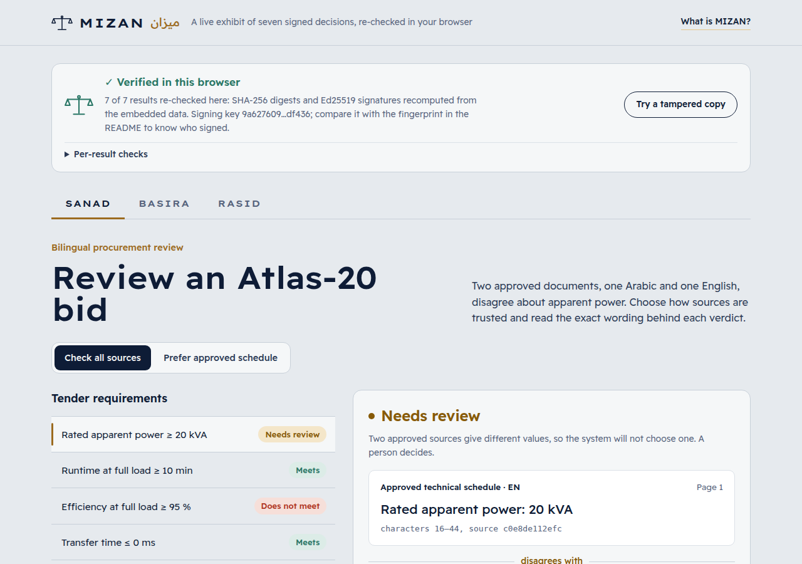
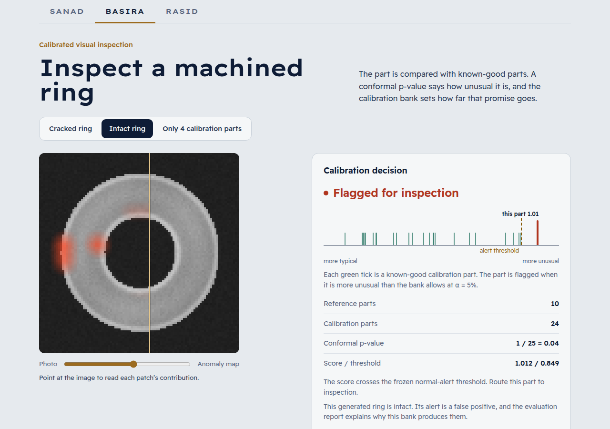
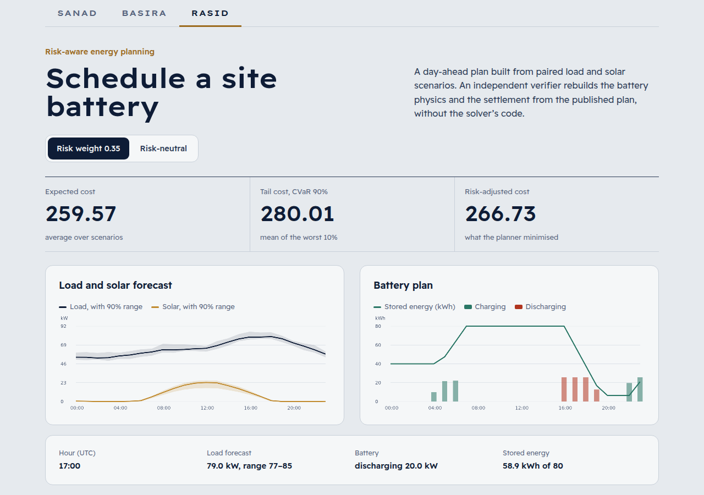

# MIZAN | Technical guide

This guide was the release README. The project overview is now in the repository's [`README.md`](../README.md). Run every command below from the repository root.

A trust layer for decisions, built for an era when AI agents make and relay them. Three local decision systems cover bilingual procurement, visual inspection and energy planning. Every answer is signed, explained only from its own proof, accompanied by executed counterfactuals, and verifiable by anyone, including inside a browser. AI agents can use it through MCP, but they cannot grant themselves authority. All bundled datasets are generated.

**Release 3.0** ([`docs/RELEASE_3.0.md`](RELEASE_3.0.md)):

- **Agents.** `python -m mizan mcp` serves the decision systems to AI agents over the Model Context Protocol. It has no approval tools, keeps prompt injection contained, gives each session a budget, and passed a conformance check with the official MCP client.
- **Explanations.** `python -m mizan explain RESULT.json --lang ar` renders Arabic and English explanations from the proof alone and executes counterfactuals: what would change the verdict, re-run through the same engine.
- **Self-verifying exhibit.** The exhibit recomputes every SHA-256 digest and Ed25519 signature in your browser. A "Try a tampered copy" button shows a forged result being rejected.
- **Safety evidence.** `python scripts/safety_suite.py` runs 40,000 deterministic-simulation steps against the real coordinator, 4,653 metamorphic relation checks, 9,000 statistical property checks and 1,600 invalid-plan mutations, with zero violations. Every deliberately broken version of the system was caught.

| SANAD · procurement evidence | BASIRA · calibrated inspection | RASID · risk-aware energy plan |
|---|---|---|
|  |  |  |

**Release 2.3** ([`docs/RELEASE_2.3.md`](RELEASE_2.3.md), visual summary in [`reports/evaluation/index.html`](../reports/evaluation/index.html)):

- **BASIRA.** Explains the 20% false-alert observation: an unlucky calibration bank, about 12.9% long-run. Every result now reports the exact probability that its bank's false-alert rate exceeds α, and an optional PAC rule bounds it.
- **RASID.** Separates forecast value from the price of risk aversion: the risk premium is +58 with a 95% interval excluding zero, and the forecast's value is −18, not resolved. Evaluates five policies, including a hindsight reference and no battery.
- **SANAD.** Grammar 3 reads multi-model datasheet tables with cell-level provenance.
- **Audit witness.** A separate trust domain countersigns the audit chain, detects rewritten or truncated history and records recovery gaps after a restore.

**Release 2.2** ([`docs/RELEASE_2.2.md`](RELEASE_2.2.md)):
- fixed a runner that could stop silently;
- made status reads constant-time and `run --out` files verifiable offline;
- added SANAD grammar 2: Arabic typography and units, and signed acknowledgement of non-evidential lines.

## Start here

Open `reports/demo/MIZAN_Demo.html` in a browser to explore the recorded runs offline. They are the signed 2.1 runs and verify against the pinned key below. For Arabic instructions see `START_HERE_AR.md`. For a single copyable Codex prompt with the full architectural amendment, use [`docs/history/MIZAN_Final_Codex_Brief.md`](history/MIZAN_Final_Codex_Brief.md).

| Product | Try this in the exhibit | Where the decision is computed |
|---|---|---|
| SANAD | Compare 16 kVA on the Arabic sheet with 20 kVA on the English schedule. Switch authority policy. Check the source span behind the new verdict. | `mizan/sanad/engine.py` |
| BASIRA | Select the intact ring and inspect its false alert. Then reduce the calibration set to four parts and read the attainable p-value. | `mizan/basira/engine.py` |
| RASID | Compare the two risk weights, expand the hourly charge schedule and export the signed results. | `mizan/rasid/forecast.py`, `solver.py`, `verify.py` |

## Run the live implementation

Use CPython 3.12 on Linux or Ubuntu under WSL2, with a local filesystem for the runtime directory. Release 2.2 was also exercised on 3.13. Run these commands from this folder. Internet access is needed to install missing packages. The core itself runs offline after installation.

```bash
python3.12 -m venv .venv
source .venv/bin/activate
python -m pip install -r requirements.txt
python -m mizan doctor
python -m mizan run sanad examples/sanad.json --out sanad-result.json
python -m mizan run basira examples/basira.json --out basira-result.json
python -m mizan run rasid examples/rasid.json --out rasid-result.json
python -m mizan verify sanad-result.json
python -m mizan serve
```

`verify` recomputes the signed execution context of a `run --out` file, or of an exhibit packet, without opening the store. `explain` verifies first, then renders the decision in Arabic and English from its proof, with executed counterfactuals.

**For AI agents (MCP).** Add this to an MCP client's configuration (Claude Desktop, IDEs, agent frameworks):

```json
{"mcpServers": {"mizan": {"command": "python", "args": ["-m", "mizan", "--data", "/abs/path/var/mizan", "mcp"],
                          "env": {"PYTHONPATH": "/abs/path/MIZAN"}}}}
```

Agents get `sanad_review_bid`, `basira_inspect`, `rasid_plan`, `explain_job`, `verify_receipt` and `audit_status`. Approving documents, changing thresholds and every deployment action stay with the human operator. The embedded key only shows internal consistency. Pass `--expected-key FINGERPRINT`, obtained through a trusted channel, to pin the publisher.

The local UI opens at `http://127.0.0.1:7860/`. It replays the recorded examples. The API at `/docs` also accepts new jobs. The private operator token is generated in `var/mizan/operator.token` on first private server startup. Send it as a Bearer token on private requests. Each submission needs an `Idempotency-Key` header. Poll the returned status URL for the result. `/readyz` reports the background runner's health. Stop the server before using another CLI command that opens its data directory, or pass `--data other/directory` before the subcommand.

**Upgrading a store created by 2.1 or 2.2.** The schema migrates automatically on first open. SANAD (grammar 3) and BASIRA (engine 3) then need a one-time signed engine promotion that keeps your source approvals:

```bash
python -m mizan upgrade
```

Until then those jobs fail with `PROFILE_UPGRADE_REQUIRED`.

**Audit witness.** Keep the witness directory outside the data directory, and preferably on another host and account. Same-host use is a protocol simulation.

```bash
python -m mizan witness-init ../mizan-witness           # once: separate key and state
python -m mizan anchor --witness ../mizan-witness       # send unwitnessed audit entries, keep receipts
python -m mizan audit --witness ../mizan-witness        # WITNESSED / UNANCHORED_TAIL / DIVERGED / REGRESSED per tenant
python -m mizan restore BACKUP NEW_DIR --accept-history-gap   # deliberate older restore; the next anchor records the gap
```

The broker checks its linked SQLite release at startup. If it reports `SQLITE_PATCH`, use an interpreter linked against an accepted SQLite release, or on a supported Linux platform install `pysqlite3-binary` with a fixed SQLite build. The broker verifies the fallback's actual version. The tested runtime used SQLite 3.53.1. [SQLite WAL release information](https://sqlite.org/wal.html#the_wal_reset_bug)

## Reproduce the evidence

```bash
python -m unittest discover -s tests -v
python verification/reference_checks.py reports/reference_verification.json
python -m mizan verify reports/demo/demo_results.json --expected-key 9a627609771982875b75b6b28ff59091f40c5a116df11c1fffb94f37a51df436
OPENBLAS_NUM_THREADS=1 OMP_NUM_THREADS=1 python scripts/evaluate.py --days 60 --out my-evaluation
python scripts/compare_evaluations.py reports/evaluation my-evaluation
python scripts/build_report.py --source my-evaluation --out my-evaluation/index.html
python scripts/safety_suite.py --quick                  # simulation, metamorphic relations, verifier fuzzing, mutants
node scripts/check_exhibit_logic.mjs                    # the exhibit's own verifier, run under Node WebCrypto
python -m mizan --data var/fresh-demo demo --out reports/rebuilt
python scripts/build_spaces.py --source reports/rebuilt/demo_results.json --out spaces-rebuilt
python scripts/check_exhibits.py --demo reports/rebuilt/MIZAN_Demo.html --spaces spaces-rebuilt --out my-browser-checks.json   # optional: Playwright + Chrome
```

The JSON reports under `reports/evaluation/` include the individual items or forecast origins and, from 2.2, the numerical environment. Expected scientific conclusions and release gates are in `docs/QUALIFICATION.md`. A newly generated store issues a new signing key. Runtime identities, receipt timestamps, timings and equally good solver schedules may differ on another machine. `compare_evaluations.py` separates the parts that must match exactly from those that may legitimately move. `reports/reproduction-2.2.json` records one such cross-environment rerun.

## Supply your own inputs

The importer accepts PDF or UTF-8 text for SANAD, PNG/JPEG files for BASIRA, and timestamped CSV records for RASID. Each subcommand has its own help. SANAD's CPU parser expects explicit model headings and supported UPS attributes. BASIRA filenames must identify independent physical parts. RASID examples use hourly `time,known_at,load_kw,pv_kw` fields and an explicit timezone. Start with 42 or more complete days so the forecast warm-up and residual window are usable.

```bash
python scripts/import_inputs.py sanad --help
python scripts/import_inputs.py basira --help    # add "guarantee": {"type": "pac", "delta": "0.1"} to the payload for a per-bank bound (needs >= 45 calibration parts at alpha 0.05)
python scripts/import_inputs.py rasid --help
```

**Approving a SANAD document.** The operator reviews each extracted transcript and original file before granting it authority. Scanned pages need an independently reviewed transcript.

```bash
python -m mizan approve-document review-document-1.json                    # show every line the grammar will not use
python -m mizan approve-document review-document-1.json --level 2 \
    --acknowledge 1:0                                                      # or --acknowledge-eligible
```

Grammar 3 also reads delimited datasheet tables (`|` or tab) whose header row starts, or for right-to-left extraction ends, with a model label: `| Model | Unit | Atlas-10 | Atlas-20 |`. Only the offered model's column becomes evidence, with the exact cell and header spans. A malformed row or an empty cell abstains.

Real transcripts usually contain titles, revision lines or page footers. Under grammar 2 such a line blocks every rule until a reviewer acknowledges it as non-evidential. The acknowledgement is bound to the page, the span and the SHA-256 of the exact quote, inside the signed profile. A line that names a scored attribute, or contains a number with a scored unit (for example `Derated 10% above 40 °C`), can never be acknowledged. Correct the transcript instead.

## Hugging Face

`spaces/sanad/`, `spaces/basira/` and `spaces/rasid/` each contain an independently usable static Space repository. Each has its own README, index, data and receipts. Upload the *contents of the selected Space folder* if you choose to publish that exhibit. Recorded exhibits contain generated samples. User files, tokens, model caches and signing keys stay in the private local runtime directory. [Static Spaces documentation](https://huggingface.co/docs/hub/spaces-sdks-static)

Three optional model experiments are present in `mizan/models.py`. They import a fixed revision, verify weights and companion files, sign the local import manifest, and verify it again before offline use. The signer's trust directory must be controlled by the operator. The optional experiments require new downloads and their own dependency resolution. The 3.0 benchmark numbers did not use these checkpoints; `reports/hf/` compares each of them with the current component on the held-out protocol (`docs/RELEASE_3.1.md`). The local control plane, strict parser, calibrated detector and MILP operate independently of those experiments.

### Reproducing `reports/hf/`

The models need torch, so they run in a separate environment, `.venv-hf`, never in `.venv`. These are the commands the recorded environment was created with (uv, Python 3.12.16, Linux x86_64), with torch pinned to the recorded build:

```bash
uv venv --python 3.12 .venv-hf
uv pip install --python .venv-hf/bin/python -r requirements.txt -e .
uv pip install --python .venv-hf/bin/python --index-url https://download.pytorch.org/whl/cpu torch==2.15.0
uv pip install --python .venv-hf/bin/python -r requirements-hf.txt
```

Install torch from the CPU index first, as above. Do not install `requirements-hf.txt` on its own: it pins `torch==2.15.0`, and PyPI serves that version as a CUDA build, not the recorded `2.15.0+cpu`. `requirements-hf.txt` pins only the packages the harness uses directly; their dependencies are not pinned there. `requirements-hf.lock.txt` lists every package of the environment that produced `reports/hf` (`uv pip freeze` of that `.venv-hf`, MIZAN itself left out). To reproduce that set exactly, use it in place of the last two lines: install torch from the CPU index as above, then `uv pip install --python .venv-hf/bin/python -r requirements-hf.lock.txt -e .`. This lock-file route has been checked only against the existing environment, not from a clean one.

Import and verify the three pinned checkpoints into `var/hf`, the default cache (`hf pins` shows a pin, `hf compare` runs the older single-item experiment):

```bash
.venv-hf/bin/python -m mizan hf fetch sanad
.venv-hf/bin/python -m mizan hf fetch basira
.venv-hf/bin/python -m mizan hf fetch rasid
```

Then run the comparison into a scratch directory, with its repeat run, and compare the result with the published files:

```bash
OPENBLAS_NUM_THREADS=1 OMP_NUM_THREADS=1 .venv-hf/bin/python scripts/evaluate_hf.py --models var/hf --out /tmp/hf --repeat
for k in basira rasid sanad; do diff <(python -m json.tool reports/hf/$k.json) <(python -m json.tool /tmp/hf/$k.json); done
```

On another machine these fields differ by design: `elapsed_seconds` and `repeat_run.elapsed_seconds` (wall time), `environment` (versions, thread variables and the CPU name), and `identity.manifest_sha256` (the SHA-256 of that machine's own signed import; `identity.manifest_object` is the same for every import of the pin). Two texts also differ because their wording was corrected after the published run: `settings.quantile_repair` in `rasid.json` (solar is clipped before planning and never scored) and `notes` in `sanad.json` (the one-label queries are read by datasheet language). Any other difference means the numerical environment differs, for example another SciPy, whose MILP solver can return different plans for the ridge risk-weighted policy (see the disclosures in `docs/RELEASE_3.1.md`).

Resources, measured on the recording machine (Intel Core i7-13645HX, WSL2 with 7 GiB of memory): the full `--repeat` run peaked at 1.1 GB resident memory (`/usr/bin/time -v`) and took about 29.5 minutes of compute, almost all of it BASIRA (868.8 s and 850.5 s for its two runs); RASID and SANAD take seconds. On disk, `var/hf` takes 588 MB and `.venv-hf` 1.3 GB (`du -sh`). No GPU is used.

`reports/hf` holds the published evidence. `--out` is required, and `reports/hf` is written only with `--repeat`, by the canonical command `python scripts/evaluate_hf.py --models var/hf --out reports/hf --repeat`; write anywhere else to check or experiment. After a new evidence run, also run `python scripts/derive_hf_intervals.py` (torch-free): `reports/hf/rasid_intervals.json` is derived from `rasid.json`, and a test requires the two to agree.

## BASIRA on real images (`reports/visa/`)

The unchanged BASIRA engine on the public VisA dataset (CC BY 4.0, real images, attribution in `docs/DATA_LICENSES.md`), under a protocol sealed before any test image was scored. Results and disclosures: `docs/RELEASE_3.2.md`. The dataset is not in the repository. Fetch it into the git-ignored `var/visa/` (torch-free, `.venv`):

```bash
python scripts/fetch_visa.py --out var/visa
```

This downloads the archive (1,929,840,640 bytes) in 16 parallel byte ranges, which resume from their `.partNN` files after an interruption. It also downloads the official split at its pinned commit, checks both SHA-256 values, extracts the images and verifies every one against `reports/visa/manifest.json`. On disk (`du -sh`): the archive takes 1.8 GiB and the extracted images 1.9 GiB.

The evaluation needs the DINOv2 pin imported into `var/hf` (`.venv-hf/bin/python -m mizan hf fetch basira`, see above). Run it into a scratch directory with its repeat run, then compare with the published record:

```bash
OPENBLAS_NUM_THREADS=1 OMP_NUM_THREADS=1 MIZAN_HF_MODELS=var/hf .venv-hf/bin/python scripts/evaluate_visa.py \
    --data var/visa --models var/hf --out /tmp/visa --repeat \
    --seal 13827ee6b1d5105c191eff3e9658d67f1ca44e62 --reason "reproduction"
diff <(python -m json.tool reports/visa/basira.json) <(python -m json.tool /tmp/visa/basira.json)
```

- **Before any image is scored**, a real run does three things. It checks that `mizan.visa.PROTOCOL` still has its sealed digest and that `--seal` names the commit that sealed it. It verifies every image against the manifest. It runs the fidelity gate: the shipped descriptor must reproduce the frozen test of `reports/evaluation/basira.json` exactly, and DINOv2 must reproduce 3.1's frozen test of `reports/hf/basira.json`. A failed gate exits with code 2 and writes nothing.
- **Fields that differ on another machine by design:** `elapsed_seconds`, `environment`, `repeat_run` (its process note), `provenance` (the commit and tree state the run started from) and `identity.dinov2.manifest_sha256` (that machine's own signed import).
- **Every run that scores VisA images is appended to `reports/visa/runs.json`, a check run included**, so the log shows each time test images were scored. `--dry-run` scores train normals only, for timing and memory, and writes no evidence.
- **The published command** is the same with `--out reports/visa`. That directory is written only with `--repeat`. A changed protocol is a new, separately labelled analysis, not a rerun.
- **After a new evidence run,** rebuild the pages with `python scripts/build_visa_report.py`, `python scripts/build_report.py` and `python scripts/build_site.py`.

Resources, measured on the recording machine (Intel Core i7-13645HX, WSL2 with 7 GiB of memory, CPU only):

- **The real run** with its repeat in a second process took 4,562.9 s (76 minutes) and peaked at 594.6 MiB resident memory (`reports/visa/runs.json`).
- **The dry run** scored the 8,659 train normals once per scorer in 1,825.1 s: the descriptor 114.4 s, DINOv2-small on the engine input 783.2 s, at native input 840.8 s.

## Recovery and qualification

Use `python -m mizan backup BACKUP_DIR` and `python -m mizan restore BACKUP_DIR NEW_DATA_DIR` offline against the intended store. Backups contain the database and referenced blobs. Retain the operator's existing trust root separately for recovery. Restore verifies the signature, database and referenced objects and creates a new generation. It checks current or explicitly supplied trusted heads. Restoring an older snapshot after further activity requires separate history reconciliation.

This release supports trusted local workers and generated portfolio experiments. Distributed failover, independent off-host witnessing, hostile-tenant isolation, accelerator qualification and real industrial evaluation have separate acceptance gates in the architectural brief. The source PDF and design history are included under `docs/design/`.
